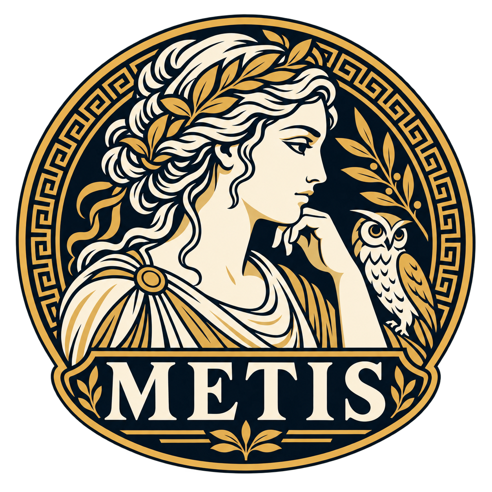

<p align="center">
  
</p>

<h1 align="center">METIS</h1>

<p align="center">
  <strong>Measurement and Evaluation of Trustworthy Intelligent Systems</strong>
</p>

<p align="center">
  
  <a href="LICENSE"></a>
  
</p>

<p align="center">
  METIS is an extensible agentic evaluation suite for assessing AI safety, alignment, and operational reliability. It ingests agent execution traces (from platforms like Langfuse and OpenTelemetry), runs configurable evaluation metrics against them, and produces diagnostics and compliance analytics.
</p>

## Table of Contents

- [Quickstart](#quickstart)
- [Development](#development)
- [Architecture](#architecture)
- [Status](#status)
- [Project Layout](#project-layout)
- [Versioning](#versioning)
- [Maintainers and contact](#maintainers-and-contact)
- [Security](#security)
- [License](#license)

## Quickstart

### Prerequisites

- Python >= 3.11
- [uv](https://docs.astral.sh/uv/) (workspace and package manager)

### Install

Clone the repository and run `make install`:

```bash
git clone https://github.com/govtech-responsibleai/metis.git
cd metis
make install
```

### Usage

See the user guides for usage instructions:

- [`docs/guide/engine.md`](docs/guide/engine.md) — evaluation engine (package details in
  [`packages/engine/README.md`](packages/engine/README.md))
- [`docs/guide/wizard.md`](docs/guide/wizard.md) — Wizard CLI, web, and API
- [`docs/guide/insights.md`](docs/guide/insights.md) — `metis insights report`, which builds the report from evaluation results
- [`docs/guide/models.md`](docs/guide/models.md) — the model and gateway of each LLM role, and the
  one `.env` file that every command reads

## Development

See [CONTRIBUTING.md](CONTRIBUTING.md) for the full contributor guide.

```bash
make check          # lint + format-check + typecheck (non-mutating)
make fix            # auto-fix lint issues and format code
make ci             # full CI suite
make clean          # remove generated/cached files
```

## Architecture

```
                        ┌─────────────┐
                        │  METIS-web  │
                        └──────┬──────┘
                               │ HTTP
                        ┌──────▼──────┐
                        │  METIS-api  │
                        └──────┬──────┘
                               │
       ┌───────────────────────┼───────────────────────┐
       │                       │                       │
┌──────▼──────┐   ┌────────────▼──────────┐   ┌────────▼─────┐
│ METIS-wizard│   │     METIS-engine      │   │METIS-insights│
│  Config Gen │   │  Evaluation Runtime   │   │  Analytics   │
└──────┬──────┘   └───────────────────────┘   └──────┬───────┘
       │                      │                      │
       │               ┌──────▼───────┐              │
       └──────────────►│METIS-library │◄─────────────┘
                       │   Catalog    │
                       └──────┬───────┘
                              │
                       ┌──────▼───────┐
                       │  METIS-core  │
                       │Domain Schemas│
                       └──────────────┘
```

| Package | Description |
|---------|-------------|
| [**metis-core**](packages/core/) | Domain schemas and standard interfaces |
| [**metis-library**](packages/library/) | Shared catalog — metrics, skills, and reusable components |
| [**metis-engine**](packages/engine/) | Evaluation runtime; ingests traces and executes metrics |
| [**metis-wizard**](packages/wizard/) | Interactive evaluation config generator |
| [**metis-insights**](packages/insights/) | Report generation from evaluation results |
| [**metis-testbed**](packages/testbed/) | Human-reviewed Wizard evaluation cases and reference Specifications |

For the full specification see [docs/architecture.md](docs/architecture.md).

## Status

**Beta.** METIS `1.0.0b1` is the state of `main` at tag `v1.0.0b1`, not a stable
release. v1 is not finished.

- **No compatibility between betas.** Anything can change from one beta to the next, including
  command-line options, Python APIs, and the HTTP API.
- **Files written by a beta may not load in v1**, because every `schema_version` is set to 2 at
  the v1 launch.
- **Support is best-effort.** We read issues and pull requests, but we do not promise response
  times. See [what to expect](CONTRIBUTING.md#support-and-contributions-during-the-beta).

## Project Layout

```
metis/
├── pyproject.toml          # Workspace root
├── metis_cli.py            # Unified CLI entry point
├── uv.lock                 # Single lockfile
├── packages/
│   ├── core/               # metis-core
│   ├── library/            # metis-library
│   ├── engine/             # metis-engine
│   ├── wizard/             # metis-wizard
│   ├── insights/           # metis-insights
│   └── testbed/            # metis-testbed
├── apps/
│   ├── api/                # REST backend
│   └── web/                # React frontend
├── tests/
│   ├── unit/
│   ├── integration/
│   └── fixtures/
└── docs/
```

## Versioning

While v1 is in beta, every package shares one version (`1.0.0b1`, `1.0.0b2`, and so on) and each
beta gets one suite tag, `v1.0.0bN`. After v1 is released, the rule below applies.

Each package maintains its own **independent semantic version**. Releases are tracked with scoped git tags (`<package-name>/v<semver>`). Every merge to `main` that modifies package source MUST be tagged with a version bump for the affected package(s).

See [CONTRIBUTING.md](CONTRIBUTING.md#versioning--release) for the full release flow and tagging conventions, and [docs/architecture.md](docs/architecture.md) for the versioning specification.

## Maintainers and contact

METIS is maintained by [@mqf20](https://github.com/mqf20) and
[@leannetan](https://github.com/leannetan). For questions, contact
[aipractice@tech.gov.sg](mailto:aipractice@tech.gov.sg).

## Security

Do not report security vulnerabilities in public issues. See [SECURITY.md](SECURITY.md)
for how to report a vulnerability.

## License

METIS is released under the [MIT License](LICENSE).
