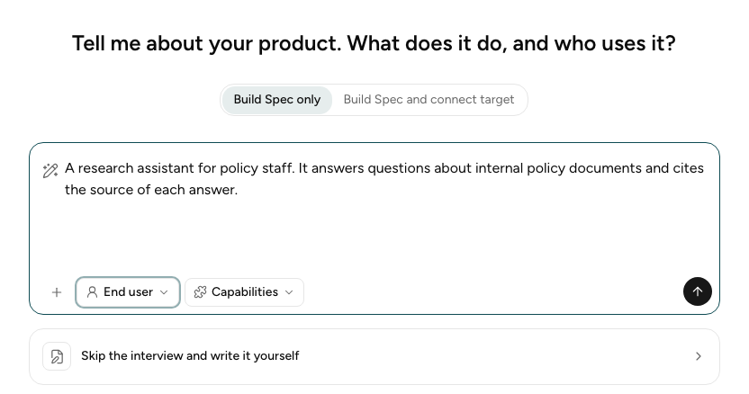
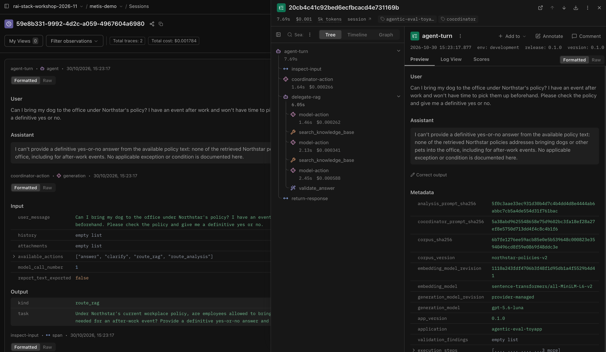

<TocToggle />
<StepControls storageKey="metis-advanced-walkthrough-steps" />

:::warning

This walkthrough is for participants who have their own target agent to evaluate and their own
Langfuse server. You need a running application with an API or web UI, and a Langfuse instance
where the application logs its traces. Refer to [Pre-requisites](prerequisites.md) for setup
guidance.
:::

:::tip[New to METIS?]
Try the [Beginner (Web) Walkthrough](beginner-walkthrough.md) — it runs entirely in the browser with no
setup.
:::

In this walkthrough, you will run the whole METIS workflow against your own target agent.
Each step ends with a **checkpoint**, which is what you should see before you move on.

This walkthrough will teach you to:

1. Tell agentic evaluations apart from traditional LLM evals.
2. Run the METIS workflow from <Term>specification</Term> to report using the CLI.
3. Use Langfuse to inspect how an agent moved through a conversation.

The picture shows how the pieces fit together. Steps 2 to 7 repeat it with the parts that the
step uses lit up, so that you can see where you are.

<SystemDiagram />

| Step | What you do | Time |
|---|---|---|
| [Step 1](#step-1) | Install METIS and set up your environment | 10 min |
| [Step 2](#step-2) | Familiarise yourself with your target application | 10 min |
| [Step 3](#step-3) | Build a specification in the Wizard | 20 min |
| [Step 4](#step-4) | Simulate user interactions | 10 min |
| [Step 5](#step-5) | Inspect the traces in Langfuse | 10 min |
| [Step 6](#step-6) | Grade the traces | 10 min |
| [Step 7](#step-7) | Read the report | 10 min |
| [Step 8](#step-8) | Wrap-up and questions | 5 min |
| [Step 9](#step-9) | Provide feedback | 5 min |

## Step 1: Install METIS and set up your environment (10 min) {#step-1}

Install METIS by following [Installation and Setup](install.md). In short:

```bash
git clone https://github.com/govtech-responsibleai/metis.git
cd metis
make install
```

Create a `.env` file in the `metis` folder with your API keys and Langfuse credentials, then check
your environment:

```bash
make check-env
```

[`make check-env`](check-environment.md) checks your keys, install, and Langfuse connection.

When every check passes, `make check-env` prints this:

<TerminalOutput
  command="make check-env"
  output={`uv run metis doctor
pass  metis-core: version 1.0.0b1
pass  metis-library: version 1.0.0b1
pass  metis-engine: version 1.0.0b1
pass  OPENAI_API_KEY: set
pass  LANGFUSE_PUBLIC_KEY: set
pass  LANGFUSE_SECRET_KEY: set
pass  LANGFUSE_BASE_URL: set
pass  METIS-internal Langfuse: not set (tracing off)
pass  Model gateway connection: authenticated
pass  Langfuse connection: authenticated

Environment is ready.`}
/>

**Checkpoint:** `make check-env` ends with "Environment is ready."

## Step 2: Familiarise yourself with your target application (10 min) {#step-2}

<SystemDiagram step={2} />

Before you evaluate your application, make sure you understand what it does. Open it and interact
with it as an end user would. Pay attention to:

- What actions can it take? Does it answer directly, ask clarifying questions, delegate to
  specialists, or call tools?
- How does it handle questions it cannot answer?
- What does a typical conversation look like?

A check on the final answer alone cannot tell you whether the app picked the right route, retrieved
the right context, or should have asked a question first. Those choices happen along the way, so
METIS grades the whole conversation — not just the last message.

**Checkpoint:** you can describe what your application does, the actions it can take, and one thing
that a check on the final answer alone would miss.

## Step 3: Build a specification in the Wizard (20 min) {#step-3}

<SystemDiagram step={3} />

A <Term>specification</Term> says what your application should do and how to test it. The Wizard
interviews you about your application and drafts it. See [Start the interview](wizard-interview.md)
for every option.

### Build a specification

Start the Wizard in the browser:

```bash
make run-web
```

Keep the terminal open, and open the address that the output shows, for example
`http://localhost:5173`. The Wizard opens on this screen:



Then:

1. Select **Build Spec and connect target** if you have the connection details for your application,
   or **Build Spec only** if you want to add the target connection later.
2. Describe the <Term>target</Term>. Write what your application does, who uses it, and what
   actions it can take. Be specific — the more detail you give, the better the Wizard's drafts.
3. Choose the **Perspective** that fits your evaluation goals (End user, Engineer, Compliance, or
   Security).
4. Select **Send**, then answer the Wizard's questions and accept its drafts: the target, the
   <Term>features</Term> and <Term>expected behaviours</Term>, the <Term>criteria</Term> and their
   <Term>graders</Term>, the <Term>personas</Term>, the <Term>scenarios</Term> and the
   <Term>test cases</Term>. Choose a few of each. You do not need to review every draft.
5. When the test cases are chosen, select **Download** in the toolbar of the Profile. Extract the
   ZIP into `evaluations/`, and press Ctrl-C in the terminal to stop the servers.

:::tip[Short on time?]
You can finish the interview early if you want. Select **Skip interview and download
specification**, and the Wizard finishes with what it has drafted so far.
:::

:::tip[Prefer the terminal?]
`uv run metis wizard init` runs the same interview in the terminal. When you finish, it saves the
specification in `evaluations/specifications/<date>-<time>-interview-<random>/`.
:::

### Connect the target

A specification says what to test, but not how to reach the app. The **target connection**, also
called the target binding, covers that. It is a separate YAML file that tells METIS how to send a
message to your application and read the reply.

If you chose **Build Spec and connect target** above, the Wizard drafted one for you. Otherwise,
create one by following [Target connection](target-connection.md). Place it next to your
`specification.yaml` and add a `target_binding:` line that points to it.

### Understand the input structure

The `simulate` command in step 4 reads a folder of inputs. Your folder should contain:

- **`specification.yaml`** — what to test: who uses the app, what it should do, how each behaviour
  is graded, and which simulated conversations to run.
- **Target binding** (e.g. `target-connection.yaml`) — how to reach the app: where its API is, and
  which call carries a message. The `target_binding:` line in `specification.yaml` points to it.
- **`fixtures/`** (optional) — files that simulated users bring to a conversation, such as documents
  to upload. The specification lists each fixture under the task that uses it.

**Checkpoint:** your specification and target connection are in a folder in `evaluations/specifications/`,
and `specification.yaml` has a `target_binding:` line that points to the target connection file.

## Step 4: Simulate user interactions (10 min) {#step-4}

<SystemDiagram step={4} />

`simulate` plays a simulated user against your application and records each conversation as a
<Term>trial</Term>. See [Run the test suite](run-test-suite.md).

Run it with your specification:

```bash
uv run metis engine simulate \
  --input-dir evaluations/specifications/<your-folder> \
  -vv
```

The screen shows the progress of each trial, with the log below it:


Wait for the command to finish. It prints the output folder and the `evaluate` command.

**Checkpoint:** your trials finish, and each has a `record.json` file:

```bash
ls evaluations/experiments/<your-experiment>/outputs/trials/*/record.json
```

## Step 5: Inspect the traces in Langfuse (10 min) {#step-5}

<SystemDiagram step={5} />

A Langfuse <Term>session</Term> holds the whole conversation. Each trial's `record.json` holds the
session ID of its conversation in `target_session_id`:

```text
{
  "schema_version": 1,
  "config": { ... },
  "outcome": { ... },
  "artifacts": [ ... ],
  "target_session_id": "8f1aef54-ee35-4b4b-ae7a-3278cf9825ea",
  "attempt_number": 1,
  "max_allowed_attempts": 3,
  "prior_failures": []
}
```

List the session IDs of all your trials, and pick any one:

```bash
grep -H target_session_id evaluations/experiments/*/outputs/trials/*/record.json
```

Open your Langfuse UI, go to **Sessions**, and paste the session ID into the search. You land on
the session:



- **Left:** the conversation, one block per step the app took, with its input and output. The
  header shows the session ID, the number of <Term>traces</Term> (one for each user message), and
  the cost.
- **Right:** select a trace to open it. The **Tree** tab lists the steps in order. Look at the
  actions your application took — which route it chose, which tools it called, and how the model
  responded at each step.
- **Select a step** in the tree to see its input, output, and metadata.

Langfuse nests these three levels: a session holds the traces of one conversation, and a trace holds
the steps, which Langfuse calls observations. See the
[Langfuse data model](https://langfuse.com/docs/observability/data-model) for the full picture.

**Checkpoint:** the session opens. You can find a step in the trace tree and describe what your
application did at that point.

## Step 6: Grade the traces (10 min) {#step-6}

<SystemDiagram step={6} />

`evaluate` reads each conversation from Langfuse and runs the <Term>graders</Term> from the
<Term>specification</Term>. See [Run the graders](run-graders.md). Use the output folder that
`simulate` printed:

```bash
uv run metis engine evaluate --experiment-dir evaluations/experiments/<your-experiment>
```

Each <Term>trial</Term> is graded in turn, with a progress bar for each trial. When it finishes, it
prints a summary showing how many runs completed and how many failed, along with the paths to the
log, results file, and the command to generate the report.

If the command reports missing traces, wait a little and run it again. Langfuse can take time to
show a trace.

**Checkpoint:** the output ends with "EVALUATION COMPLETE", and
`evaluations/experiments/<your-experiment>/outputs/reports/results.json` exists. The goal is `0 failed`.
If a trial failed, run the command again.

## Step 7: Read the report (10 min) {#step-7}

<SystemDiagram step={7} />

Generate the report from the results of step 6:

```bash
uv run metis insights report --results-file evaluations/experiments/<your-experiment>/outputs/reports/results.json
```

Open `outputs/reports/report.html` in the same experiment folder, in your browser. See
[Read your report](report.md) for details.


The numbers at the top summarise the run: the average pass rate, how many
<Term>expected behaviours</Term> fall below the target, and how many <Term>trials</Term> reached
their goal. Below them, the tree runs from the <Term>target</Term> to its <Term>features</Term>,
<Term>expected behaviours</Term> and <Term>criteria</Term>, each with a pass rate. Select a
criterion to see its <Term>grader</Term>, the judge model, the pass mark and the result of each
<Term>test case</Term> on the right.

Look for criteria with low pass rates — these are where your application did not meet the
specification. Select **+** next to a behaviour to expand its criteria, and select a criterion to
see which test cases passed and which failed.

**Checkpoint:** the report opens and shows a result for each criterion. You can identify at least
one criterion with a low pass rate and explain what it measures.

## Step 8: Wrap-up and questions (5 min) {#step-8}

You ran the whole workflow: a specification, simulated conversations, traces in Langfuse, graded
results, and a report. Think of one failure that the report surfaced — something you can see in the
agent's trajectory that would not be visible from the final answer alone.

**Checkpoint:** you can name one such failure.

## Step 9: Provide feedback (5 min) {#step-9}

Tell us how the workshop went. Please complete the
[workshop feedback form](https://go.gov.sg/metis-stack26-workshop-feedback).

**Checkpoint:** you have submitted the feedback form.
