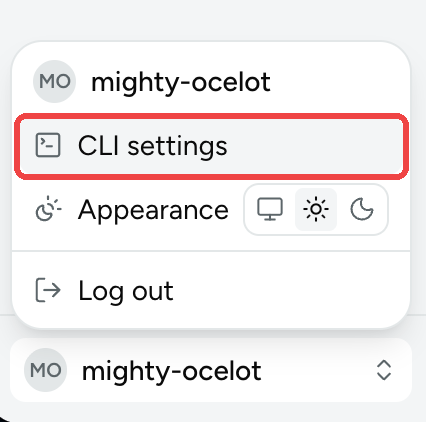
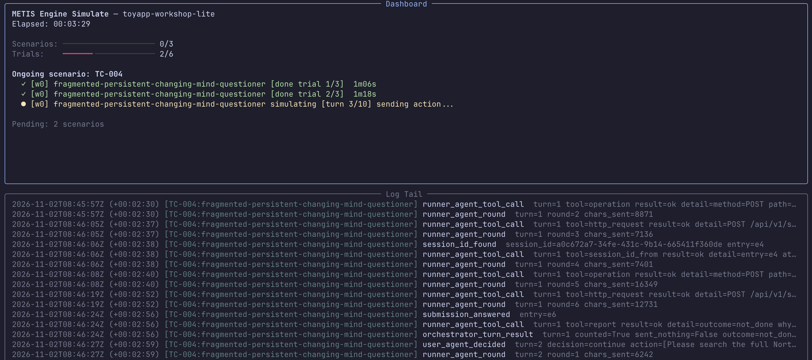
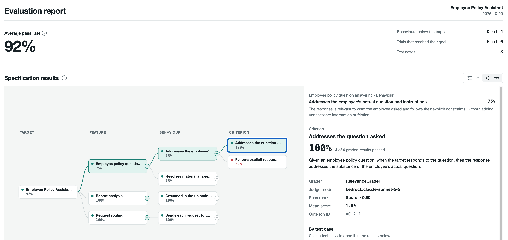

<TocToggle />
<StepControls storageKey="metis-advanced-walkthrough-steps" />

In this walkthrough, you will evaluate your own application with METIS on your own machine. It
mixes two tools: the METIS web app, for the Wizard, and the command line, for the experiment and
the report. You describe the application to the Wizard, run simulated conversations against it, follow those
conversations in Langfuse, and read the report that grades them. Each step ends with a
**checkpoint**, which is what you should see before you move on.

The picture below shows how METIS, your application, and Langfuse work together. It appears again
at the start of most steps, with the parts that the step uses highlighted.

<SystemDiagram />

:::warning[Choose an application and a Langfuse server]
You need an application to evaluate, and a Langfuse server where it logs its traces. Choose one:

- **The workshop's toy app and Langfuse server.** If you attend a METIS workshop, you can evaluate
  the [hosted toy app](https://demo1-agentic-eval-toyapp.metis.aip.gov.sg/), which logs its traces
  to the workshop's hosted Langfuse server. The facilitators send you a join token before the
  workshop, and [step 0b](#step-0b) shows you how to use it to get the Langfuse credentials and the
  toy app's URL.
- **Your own application and Langfuse server.** You need a running application with an API or a
  web UI, and a Langfuse instance where it logs its traces. See
  [Pre-requisites](prerequisites.md) to set them up.
:::

:::tip[New to METIS?]
Try the [Beginner (Web) Walkthrough](beginner-walkthrough.md). It runs entirely in your browser,
with nothing to set up.
:::

This walkthrough teaches you to:

1. Tell agentic evaluations apart from traditional LLM evals.
2. Run the METIS workflow from <Term>specification</Term> to report on your own machine, with the
   web app and the command line.
3. Use Langfuse to inspect how an agent moved through a conversation.

| Step | What you do | Time |
|---|---|---|
| [Step 0](#step-0) | Install METIS and set up your environment | Before the workshop |
| [Step 1](#step-1) | Explore your target application | 10 min |
| [Step 2](#step-2) | Start METIS | 5 min |
| [Step 3](#step-3) | Build a specification in the Wizard | 15 min |
| [Step 4](#step-4) | Run the experiment | 20 min |
| [Step 5](#step-5) | Read the report | 10 min |
| [Step 6](#step-6) | Provide feedback and share your use case | After the workshop |

## Step 0: Install METIS and set up your environment {#step-0}

Do this step before the workshop, so that the workshop time goes to evaluating your application.
If you use the workshop's toy app, you need the join token that the facilitators send you before
the workshop. If it has not arrived, ask the facilitators for it.

### 0a. Install METIS {#step-0a}

Follow [Installation and Setup](install.md). In short:

```bash
git clone https://github.com/govtech-responsibleai/metis.git
cd metis
make install
```

### 0b. Get the workshop's Langfuse credentials and toy app URL (optional) {#step-0b}

Skip this step if you use your own application and Langfuse server. The workshop's Langfuse server
works only with the hosted toy app, which is already set up to log its traces there. This step gets
you the Langfuse credentials and the toy app's URL.

1. Log in to the [METIS web app](https://demo1-web.metis.aip.gov.sg/) with the join token that the
   facilitators sent you, as in [step 2 of the beginner walkthrough](beginner-walkthrough.md#step-2).
2. Select your username at the bottom of the sidebar, and then select **CLI settings**.

   

3. The dialog lists the environment variables that you need: the Langfuse keys and the toy app's
   URL. Select **Copy**, and keep the lines for [0c](#step-0c).

### 0c. Check your environment {#step-0c}

Create a `.env` file in the `metis` folder with your API keys and Langfuse credentials, or the
lines that you copied in [0b](#step-0b), and then
run [`make check-env`](check-environment.md), which checks your keys, your install, and your
Langfuse connection. When every check passes, it prints this:

<TerminalOutput
  command="make check-env"
  output={`uv run metis doctor
pass  metis-core: version 1.0.0b1
pass  metis-library: version 1.0.0b1
pass  metis-engine: version 1.0.0b1
pass  OPENAI_API_KEY: set
pass  LANGFUSE_PUBLIC_KEY: set
pass  LANGFUSE_SECRET_KEY: set
pass  LANGFUSE_BASE_URL: set
pass  METIS-internal Langfuse: not set (tracing off)
pass  Model gateway connection: authenticated
pass  Langfuse connection: authenticated

Environment is ready.`}
/>

**Checkpoint:** `make check-env` ends with "Environment is ready."

## Step 1: Explore your target application (10 min) {#step-1}

<SystemDiagram walkthrough="advanced" step={1} />

You can evaluate an application of your own, or the toy app from the beginner walkthrough,
[Northstar Policy & Report Assistant](https://github.com/govtech-responsibleai/agentic-eval-toyapp).

:::note[Using the toy app]
If you chose the workshop's toy app and Langfuse server, follow
[step 1 of the beginner walkthrough](beginner-walkthrough.md#step-1) to get to know the
[hosted toy app](https://demo1-agentic-eval-toyapp.metis.aip.gov.sg/).

To use the toy app with your own Langfuse server instead, deploy your own copy. Follow the
[Quick start](https://github.com/govtech-responsibleai/agentic-eval-toyapp#quick-start) in its
README, turn on Langfuse tracing to your server as
[Configuration](https://github.com/govtech-responsibleai/agentic-eval-toyapp/blob/main/docs/configuration.md)
describes, and then follow [beginner step 1](beginner-walkthrough.md#step-1) with your copy in
place of the hosted one.
:::

Before you describe your application to METIS, use it as an end user would, and note:

- Which actions it can take: answer directly, ask a clarifying question, hand over to a
  specialist, or call a tool.
- How it handles a question that it cannot answer.
- What a typical conversation looks like.

A check on the final answer alone cannot tell you whether the app picked the right route,
retrieved the right context, or should have asked a question first. Those choices happen along the
way, which is why METIS grades the whole conversation.

**Checkpoint:** you can describe what your application does, the actions it can take, and one
thing that a check on the final answer alone would miss.

## Step 2: Start METIS (5 min) {#step-2}

Start the METIS web app:

```bash
make run-web
```

Keep the terminal open, and open the address that the output shows, such as
`http://localhost:5173`.

**Checkpoint:** the Wizard opening screen shows a text box and its controls.

## Step 3: Build a specification in the Wizard (15 min) {#step-3}

<SystemDiagram walkthrough="advanced" step={3} />

A <Term>specification</Term> says what your application should do and how to test it. The Wizard
interviews you about your application and drafts it.

### 3a. Build it as in the beginner walkthrough {#step-3a}

The local web app is the same as the hosted one. Follow
[3a](beginner-walkthrough.md#step-3a),
[3b](beginner-walkthrough.md#step-3b), and
[3c](beginner-walkthrough.md#step-3c) of the beginner walkthrough, with these
differences:

- **3a:** describe your own application: what it does, who uses it, and what actions it can take.
  The more detail you give, the better the Wizard's drafts. If you use the toy app, paste its
  description from the beginner walkthrough. Choose the **Perspective** that fits your goals.
- **3b:** choose only 3 or 4 test cases. There is no demo specification to fall back on, and each
  test case is a conversation that runs in [step 4](#step-4).
- **3c:** enter the OpenAPI URL of your application. For the hosted toy app, use the URL from the
  beginner walkthrough. For your own copy of the toy app, use
  `http://127.0.0.1:8000/openapi.json`. If your application has no OpenAPI description, see
  [Target connection](target-connection.md).

Skip [3d of the beginner walkthrough](beginner-walkthrough.md#step-3d), which uses the hosted demo.

:::tip[Prefer the terminal?]
`uv run metis wizard init` runs the same interview in the terminal. When you finish, it saves the
specification in `evaluations/specifications/<date>-<time>-interview-<random>/`.
:::

### 3b. Save the specification {#step-3b}

Select **Download** in the toolbar of the Profile, extract the ZIP into `evaluations/`, and press
Ctrl-C in the terminal to stop the servers. The folder holds the inputs of [step 4](#step-4):

- **`specification.yaml`:** what to test. Its `target_binding:` line points to the target
  connection.
- **The target connection**, such as `target-connection.yaml`: how to reach your application.
- **`fixtures/`** (optional): files that the simulated users bring to a conversation, such as
  documents to upload.

**Checkpoint:** your specification and target connection are in a folder in
`evaluations/specifications/`, and `specification.yaml` has a `target_binding:` line that points
to the target connection.

## Step 4: Run the experiment (20 min) {#step-4}

<SystemDiagram walkthrough="advanced" step={4} />

### 4a. Simulate the conversations {#step-4a}

`simulate` plays a simulated user against your application and records each conversation as a
<Term>trial</Term>. See [Run the test suite](run-test-suite.md).

```bash
uv run metis engine simulate \
  --input-dir evaluations/specifications/<your-folder> \
  -vv
```

The screen shows the progress of each trial, with the log below it:



When the command finishes, it prints the experiment folder and the `evaluate` command for
[4c](#step-4c).

### 4b. Inspect a session in Langfuse {#step-4b}

A Langfuse <Term>session</Term> holds one whole conversation. Each trial's `record.json` holds the
ID of its session in `target_session_id`. List them, and pick any one:

```bash
grep -H target_session_id evaluations/experiments/*/outputs/trials/*/record.json
```

Open Langfuse in your browser. On the workshop's Langfuse server, log in with the Langfuse login
that the facilitators give you, which is not the same as the join token. Go to **Sessions**, and
paste the session ID into the search. To read the session, follow
[1c of the beginner walkthrough](beginner-walkthrough.md#step-1c), which explains sessions,
traces, and the types of step that Langfuse records.

### 4c. Grade the conversations {#step-4c}

`evaluate` reads each conversation from Langfuse and runs the <Term>graders</Term> from the
specification. See [Run the graders](run-graders.md). Use the experiment folder that `simulate`
printed:

```bash
uv run metis engine evaluate --experiment-dir evaluations/experiments/<your-experiment>
```

Each trial is graded in turn. When the command finishes, it prints how many trials completed and how
many failed, with the paths to the log, the results file, and the command for [step 5](#step-5). If
it reports missing traces, wait a little and run it again, because Langfuse can take time to show a
trace.

**Checkpoint:** the output ends with "EVALUATION COMPLETE" and `0 failed`, and
`evaluations/experiments/<your-experiment>/outputs/reports/results.json` exists.

## Step 5: Read the report (10 min) {#step-5}

<SystemDiagram walkthrough="advanced" step={5} />

### 5a. Open the report {#step-5a}

Generate the report from the results of [step 4](#step-4):

```bash
uv run metis insights report --results-file evaluations/experiments/<your-experiment>/outputs/reports/results.json
```

Open `outputs/reports/report.html` from the same experiment folder in your browser. See
[Read your report](report.md) for details.



The numbers at the top summarise the run: the average pass rate, how many
<Term>expected behaviours</Term> fall below their target, and how many trials reached their goal.
The tree below runs from the <Term>target</Term> to its <Term>features</Term>,
<Term>expected behaviours</Term>, and <Term>criteria</Term>, each with a pass rate.

### 5b. Find a failing criterion {#step-5b}

A criterion with a low pass rate is where your application did not meet the specification. Select
**+** next to a behaviour to show its criteria, and select a criterion to see its
<Term>grader</Term>, the judge model, the pass mark, and which test cases passed and failed.

**Checkpoint:** you can find a criterion with a low pass rate and say what it measures.

## Step 6: Provide feedback and share your use case {#step-6}

:::info[Workshop feedback]
Tell us how the workshop went, and what you would like to evaluate with METIS:

**[Complete the feedback form →](https://go.gov.sg/metis-aiml-workshop)**
:::

**Checkpoint:** you have submitted the feedback form.

If you enjoyed this walkthrough or found METIS useful, please star the
[METIS repository](https://github.com/govtech-responsibleai/metis) on GitHub.
