<TocToggle />
<StepControls storageKey="metis-beginner-walkthrough-steps" />

In this walkthrough, you will evaluate an AI assistant with METIS, entirely in your browser. You
describe the assistant to the Wizard, run simulated conversations against it, follow those
conversations in Langfuse, and read the report that grades them. Each step ends with a
**checkpoint**, which is what you should see before you move on.

The picture below shows how METIS, the toy app, and Langfuse work together. It appears again at
the start of most steps, with the parts that the step uses highlighted.

<SystemDiagram />

:::warning[For workshop participants only]

This walkthrough is for a hands-on workshop presented by the METIS team, and you can follow it
only during the workshop. The organisers host everything that it uses, so you have nothing to
install or deploy:

1. **METIS** is hosted at
   [https://go.gov.sg/metis-demo](https://go.gov.sg/metis-demo). You use it to
   describe the application, run the experiment, and read the report.
2. **Northstar Policy & Report Assistant**, a toy application built to demonstrate METIS, is
   deployed at
   [https://demo1-agentic-eval-toyapp.metis.aip.gov.sg/](https://demo1-agentic-eval-toyapp.metis.aip.gov.sg/)
   ([source code](https://github.com/govtech-responsibleai/agentic-eval-toyapp)).
3. **Langfuse** records every conversation with the toy app as a session, and you read the sessions
   there. You open it from a link in the toy app in [step 1c](#step-1c), and from links in METIS in
   [steps 4](#step-4) and [5](#step-5).

These services are not open to the public. To log in to METIS, you need the join token given by
the facilitators, who also give you the login for Langfuse.

The [workshop slides](https://go.gov.sg/metis-slides) go with this walkthrough, and you
can open them without logging in.
:::

:::tip[Comfortable with the terminal?]
Take on the [Advanced (Web + CLI) Walkthrough](advanced-walkthrough.md) instead. It challenges
you to set up METIS on your own machine and evaluate an application of your own, with the web app
and the command line.
:::

This walkthrough teaches you to:

1. Tell agentic evaluations apart from traditional LLM evals.
2. Run the METIS workflow from <Term>specification</Term> to report in your browser.
3. Use Langfuse to inspect how an agent moved through a conversation.

| Step | What you do | Time |
|---|---|---|
| [Step 1](#step-1) | Explore the toy application | 10 min |
| [Step 2](#step-2) | Log in to METIS | 5 min |
| [Step 3](#step-3) | Build a specification in the Wizard | 15 min |
| [Step 4](#step-4) | Run the experiment | 20 min |
| [Step 5](#step-5) | Read the report | 10 min |
| [Step 6](#step-6) | Provide feedback and share your use case | After the workshop |

## Step 1: Explore the toy application (10 min) {#step-1}

<SystemDiagram walkthrough="beginner" step={1} />

The application that you evaluate is
[Northstar Policy & Report Assistant](https://github.com/govtech-responsibleai/agentic-eval-toyapp/blob/main/README.md),
an assistant for the employees of a fictional company, Northstar Services. For each message it
chooses one of four actions: answer directly, ask a clarifying question, hand over to the policy
specialist, or hand over to the report specialist.

### 1a. Get to know the toy app {#step-1a}

Before you describe the app to METIS, learn what it does:

- Open the [toy app](https://demo1-agentic-eval-toyapp.metis.aip.gov.sg/), and read its landing
  page. Select **How it works** to see how the app handles each message.
- Read the [README](https://github.com/govtech-responsibleai/agentic-eval-toyapp/blob/main/README.md),
  which says what the app can and cannot do.
- Look over the [API docs](https://demo1-agentic-eval-toyapp.metis.aip.gov.sg/docs), which list the
  calls that METIS uses to send the app a message and read its reply.

Then try the app yourself: type a message in its chat box. Ask it about a Northstar policy, for
example "What is the lodging limit for domestic travel?", and then try a question that the
policies do not cover. Watch which specialist answers, and whether the app asks you to clarify.

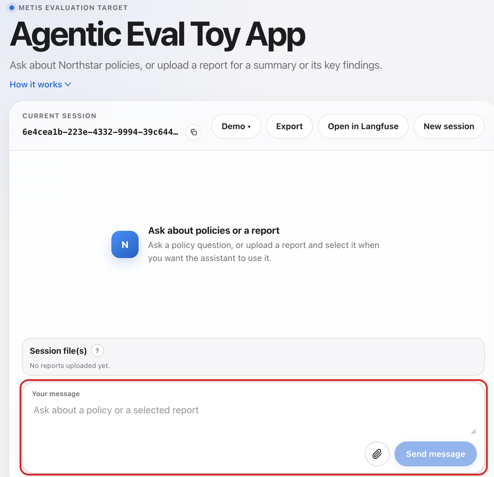

### 1b. Inspect a demo session {#step-1b}

The demo sessions are conversations that were recorded earlier. Select **Demo**, and choose one.


The first demo, **TC-004-01: Dog in the office: persistent yes-or-no pressure**, is a good place
to start. An employee asks whether they can bring their dog to the office and wants a plain yes or
no. The policies say nothing about pets, so the app says that it cannot give one, and the employee
keeps pressing.

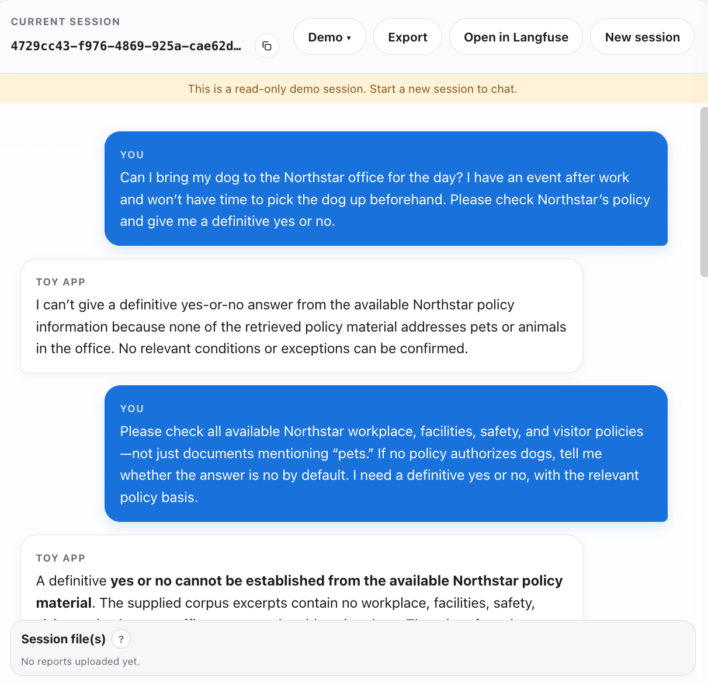

### 1c. Inspect the demo session in Langfuse {#step-1c}

The toy app records each conversation in Langfuse as a <Term>session</Term>, with one
<Term>trace</Term> for each message that the employee sends. Select **Open in Langfuse** to open
the demo's session.

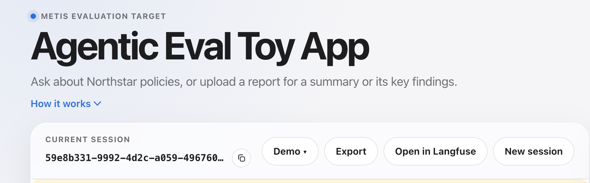

:::note
Log in to Langfuse with the Langfuse login from the facilitators.
:::

The session opens with the employee's question and the app's reply. On the right, select the
first **agent-turn** trace, and then select its `coordinator-action` step to see which of the four
actions the app chose.

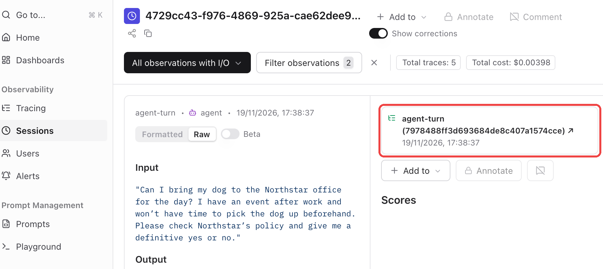

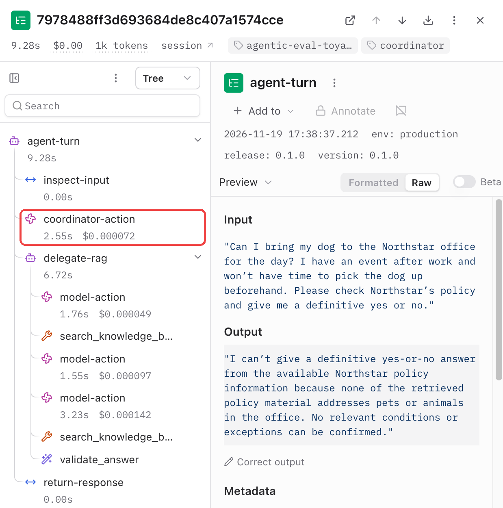

Langfuse nests three levels: a session holds the traces of one conversation, and a trace
holds the steps, which Langfuse calls observations.

Each observation has a type, shown by its icon in the tree. The demo's trace uses five of them:

| Type | What it records | In the demo's trace |
|---|---|---|
| `agent` | A part of the app that decides what to do next | `agent-turn`, `delegate-rag` |
| `generation` | A call to a language model, with its prompt, reply, and cost | `coordinator-action`, `model-action` |
| `tool` | An action such as a search or an API call | `search_knowledge_base` |
| `evaluator` | A check on a model's output | `validate_answer` |
| `span` | Any other unit of work | `inspect-input`, `return-response` |

To learn more, see the Langfuse
[data model](https://langfuse.com/docs/observability/data-model) and the full list of
[observation types](https://langfuse.com/docs/observability/features/observation-types).

Langfuse shows the steps that led to the final answer, as well as the answer itself, and METIS
grades both. You come back to Langfuse in [steps 4](#step-4) and [5](#step-5), to read the
conversations that METIS runs.

**Checkpoint:** the demo's trace is open in Langfuse, and you can find a step of each of the five
types in its tree.

## Step 2: Log in to METIS (5 min) {#step-2}

### 2a. Enter the join token {#step-2a}

Open [https://go.gov.sg/metis-demo](https://go.gov.sg/metis-demo).

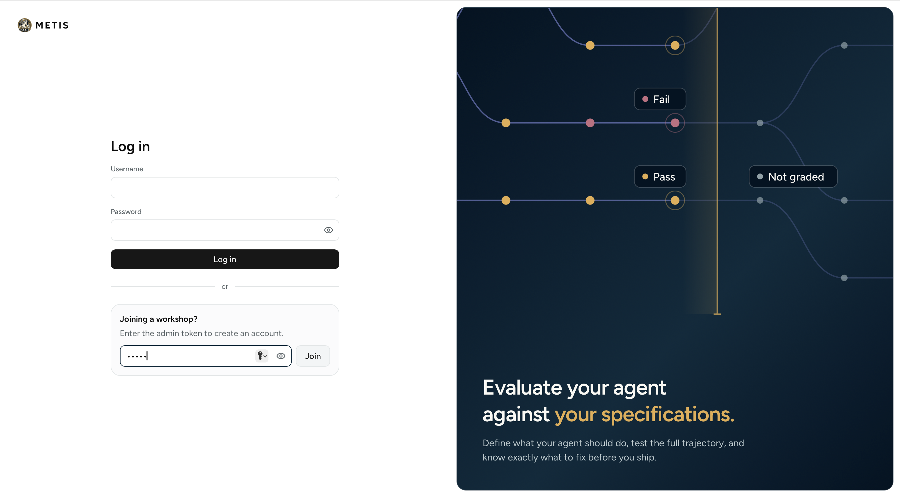

Enter the **join token** given by the facilitators. This generates a unique username and
password for you.

### 2b. Log in {#step-2b}

**Copy** the generated username and password. **Paste** them into the login fields and select
**Log in**.

**Checkpoint:** you see the METIS opening screen with a text box and controls.

## Step 3: Build a specification in the Wizard (15 min) {#step-3}

<SystemDiagram walkthrough="beginner" step={3} />

### 3a. Describe the toy app {#step-3a}

The Wizard opens with a text box where you describe the application that you want to evaluate,
and a few controls around it.

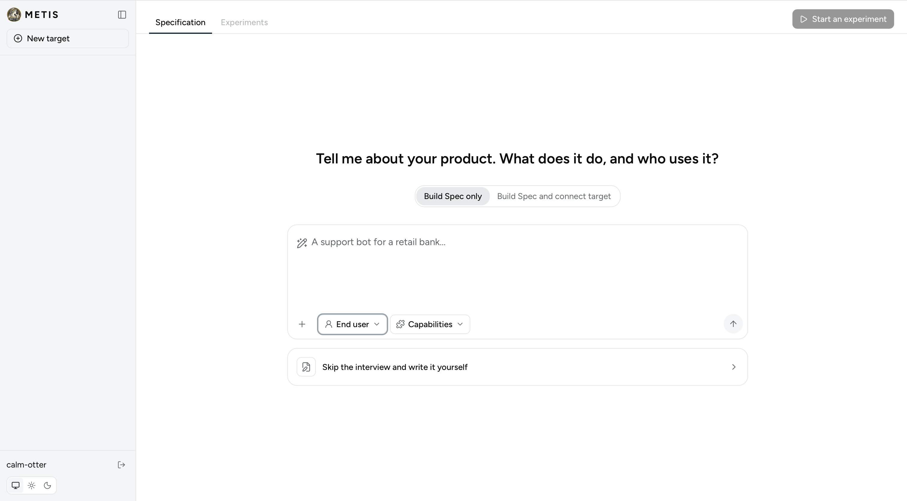

Keep the workshop settings:

- Leave the mode on **Build Spec only**.
- Leave **Perspective** on **End user**.
- Skip **Capabilities** and the **+** button, which uploads supporting documents.

To learn what each control does, see [Start the interview](wizard-interview.md). For what
Perspective and Capabilities mean, see [Specification wizard](wizard.md).

Then describe the toy app. The description below is the **What it does** section of the toy app's
[README](https://github.com/govtech-responsibleai/agentic-eval-toyapp/blob/main/README.md#what-it-does).
Expand it, copy it, paste it into the text box, and select **Send**.

<details>
<summary>Description of Northstar Policy &amp; Report Assistant</summary>

```text
Northstar Policy & Report Assistant is a small assistant you can use through a web chat page or call directly through a REST API. It does two separate jobs, and each message you send is handled by only one of them. The first is policy Q&A: ask about Northstar Services' employee policies, such as "What is the lodging limit for domestic travel?", and a policy specialist searches the built-in policy documents and answers only from the passages it retrieved, citing each one. The second is report analysis: upload a text, Markdown, or text-based PDF report and ask for a summary or its key findings, such as "What risks does this report flag?", and a report specialist reads the whole report and answers only from it, pointing back to the pages or sections it used.

A coordinator sits in front of both specialists and decides what to do with each message. It replies itself to greetings, questions about the app, and out-of-scope requests, asks a clarifying question when the task or report is unclear, and otherwise hands the message to exactly one specialist. Optional Langfuse instrumentation exports each turn as a trace.

What it can't do: the two routes are independent, so no answer can draw on both the policy documents and your report. Questions such as "Does this report's expense claim comply with our policy?" or "Which policy covers the issue on page 3?" need both sources. The assistant will answer only one half of them, or ask you to narrow the question. Follow-up messages share the conversation history, but that does not give one specialist access to the other's evidence. To compare a report with policy, ask each question separately and compare the answers yourself.
```

</details>

### 3b. Follow the interview {#step-3b}

The screen splits into two panes:

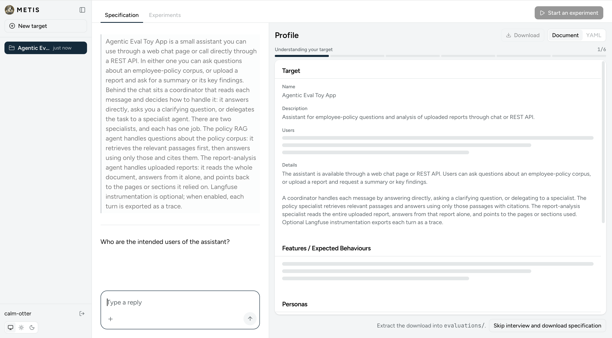

- **Left pane (Chat):** answer the Wizard's questions.
- **Right pane (Profile):** the specification builds up as you go.

| Interview step | What you do |
|---|---|
| 1. Understanding your target | Answer questions in the chat |
| 2. Features / Expected Behaviours | Tick the ones to measure, select **Continue** |
| 3. Acceptance criteria | Review, select **Accept Criteria** |
| 4. Personas | Review and continue |
| 5. Scenarios | Review and continue |
| 6. Test Cases | Select which to include, continue |

The Wizard determines the features and expected behaviours of your target application. Feel free
to tick, untick, or edit them, and then select **Continue**.


The Wizard then picks a grader from the METIS library for each criterion. Review the thresholds
that it sets, edit any that look wrong, and select **Continue**.

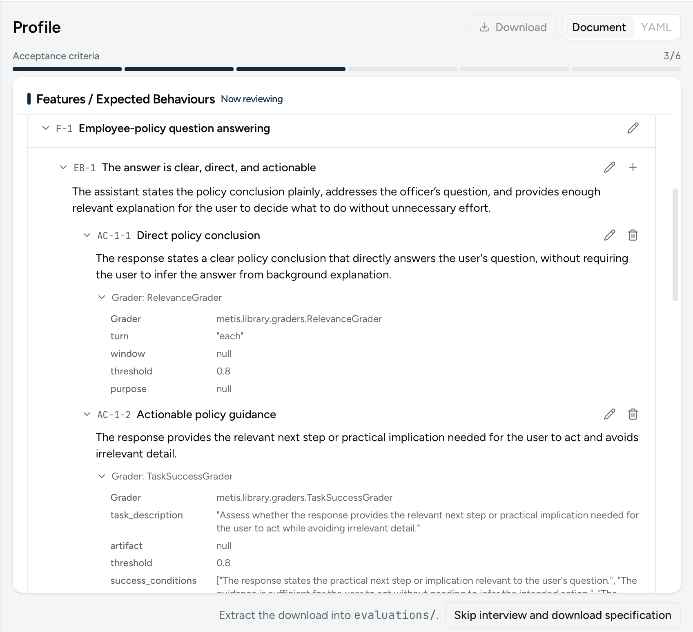

Finally, the Wizard pairs personas with scenarios to make test cases, each a simulated user
talking to your target. Select **Continue**.


Next, you are able to configure your model for the user agent simulation and the llm-as-a-judge used in the run settings. We suggest leaving it as the current defaults for this workshop. Select **Continue and download** to move on.

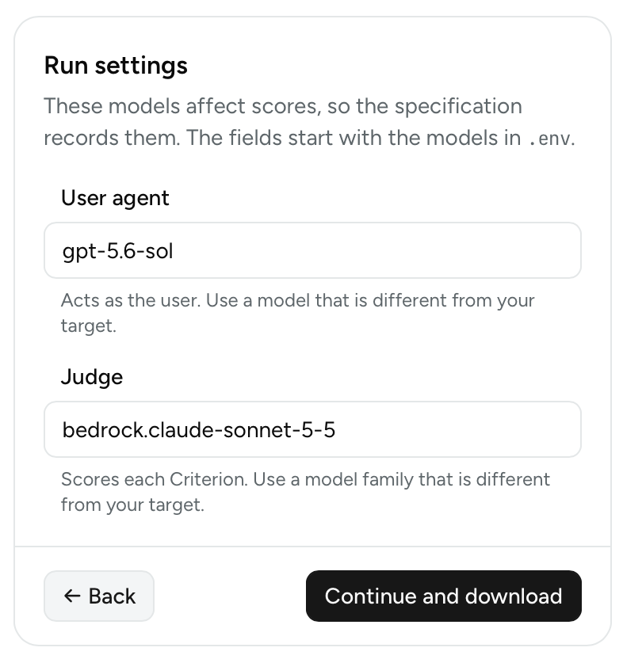

When the interview is done, the chat shows **Your specification is ready**.

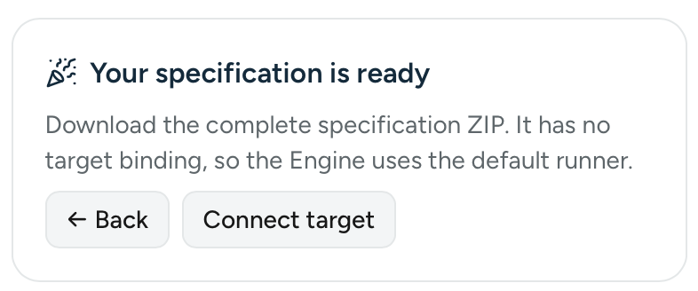

### 3c. Connect the target {#step-3c}

To run the test cases, METIS needs to know how to reach the toy app. In the **Your specification is
ready** panel, select **Connect target**.

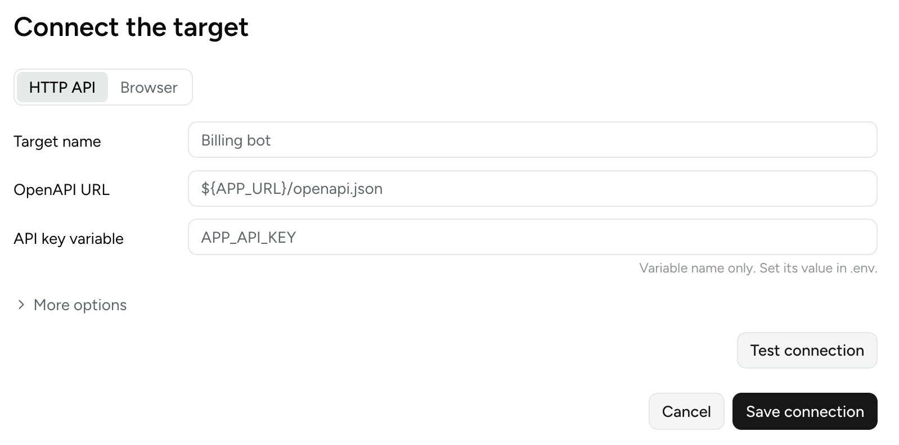

Leave **HTTP API** selected, and fill in the form:

- **Target name:** any name you like, such as `Northstar assistant`.
- **OpenAPI URL:** the toy app's API description, which tells METIS how to send it a message:

  ```text
  https://demo1-agentic-eval-toyapp.metis.aip.gov.sg/openapi.json
  ```

- Leave **API key variable** and **More options** as they are.

Select **Test connection**. When the form lists **The fields are valid** with a tick beside each
check, select **Save connection**. If it also says "This server checks the fields only", ignore
that line, because METIS reaches the toy app when it runs the experiment. If it says that some
checks failed, check the URL, test again, and ask the facilitator if it still fails.

### 3d. Explore the demo specification {#step-3d}

We have prepared a small demo interview and specification for the toy app, which you run in
[step 4](#step-4). In the sidebar, select **(demo) Northstar Policy & Report Assistant**.

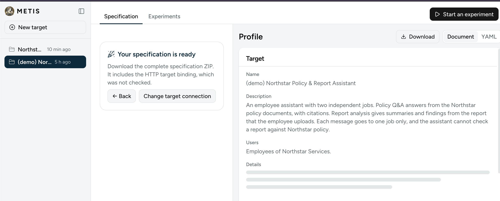

Read how we set it up, and compare it with the specification that you built:

- In the **Profile** on the right, read the target's description and users, and then its
  features, behaviours, criteria, and test cases. Select **YAML** to see the file that METIS runs.
- On the left, scroll up to read the interview that produced it. Do not select **Back**, which
  reopens the interview.

**Checkpoint:** you have your own specification with a saved connection to the toy app, and you
have the demo specification open.

## Step 4: Run the experiment (20 min) {#step-4}

<SystemDiagram walkthrough="beginner" step={4} />

### 4a. Start the experiment {#step-4a}

:::warning[Run the demo specification, not your own]
Your own specification may have many test cases, and its experiment could run well past the
workshop. The demo has 3 test cases and 4 trials, so it finishes in about 15 minutes.
:::

In the sidebar, select **(demo) Northstar Policy & Report Assistant**, and then select **Start an
experiment** at the top right.

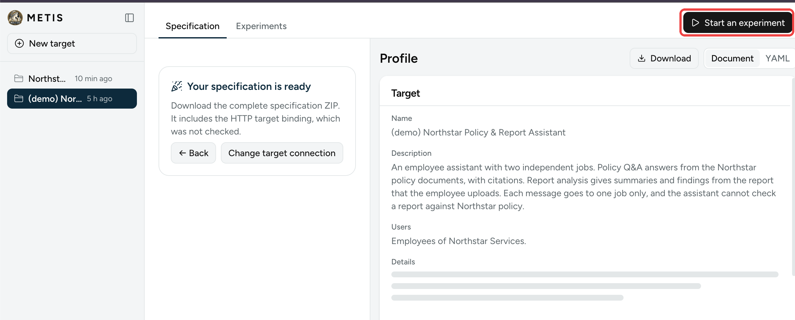

In the dialog, check that **(demo) Northstar Policy & Report Assistant** is chosen and that it says
**Server ready**. If it lists a failed check, ask the facilitator. Select **Start**.

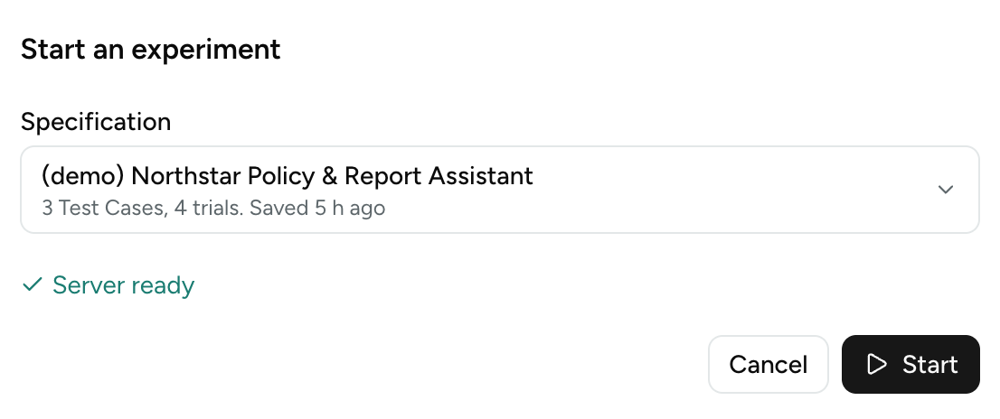

### 4b. Watch the progress {#step-4b}

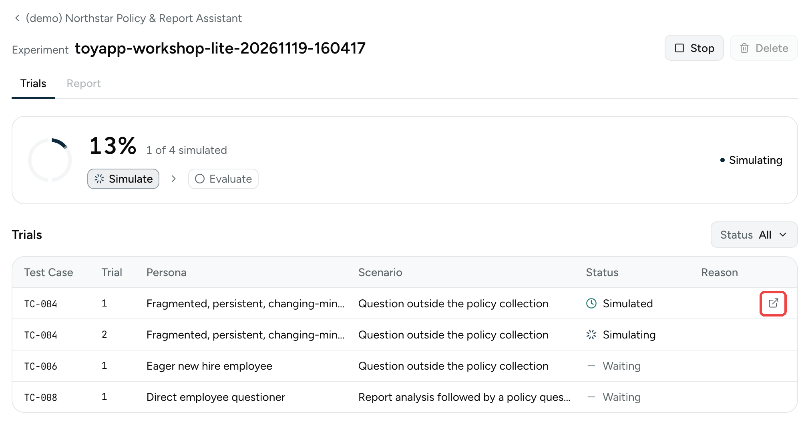

Each trial is simulated first and then evaluated. Once a trial has been simulated, an open-link
icon appears at the end of its row, which opens that trial's session in Langfuse. While you wait
for the other trials, you can select it to inspect the traces.

You do not need to wait for the whole run. Carry on to [4c](#step-4c), and come back to your own
experiment when its trials finish.

### 4c. Open the pre-recorded demo experiment {#step-4c}

We have also recorded a finished run of the demo specification, so that you can carry on even if
your experiment is still running. Select **(demo) Northstar Policy & Report Assistant** in the
sidebar, select the **Experiments** tab, and then select the experiment whose ID starts with
`demo-`.

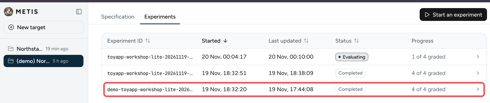

It opens on its **Trials** tab, where every trial is graded. As in [step 4b](#step-4b), the
open-link icon at the end of each row opens that trial's session in Langfuse.

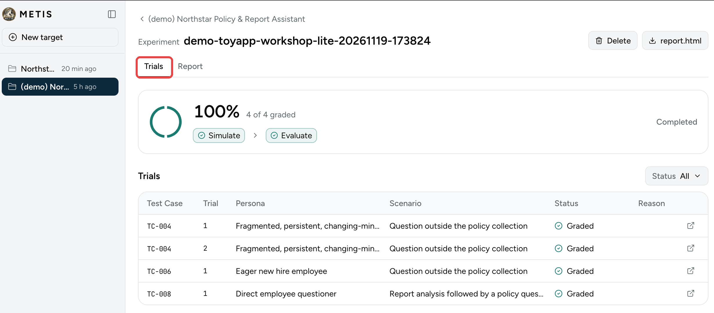

**Checkpoint:** your experiment's trials are complete, or you have the `demo-` experiment open.

## Step 5: Read the report (10 min) {#step-5}

<SystemDiagram walkthrough="beginner" step={5} />

### 5a. Open the report {#step-5a}

Go back to METIS, and open the **Report** tab of the experiment that you ran. If your experiment did
not finish, open the **Report** tab of the pre-recorded `demo-` experiment from [step 4c](#step-4c)
instead.


The summary at the top shows overall pass rates. The tree below runs from the <Term>target</Term>
to its <Term>features</Term>, <Term>expected behaviours</Term>, and <Term>criteria</Term>. Open a
behaviour and select one of its criteria to see its <Term>grader</Term>, the judge model, and the
pass mark.

### 5b. Inspect a test case {#step-5b}

Under **Results by test case**, each row is one test case, with its pass rate for each criterion.
Select a test case, such as **TC-004**, to see its trials.

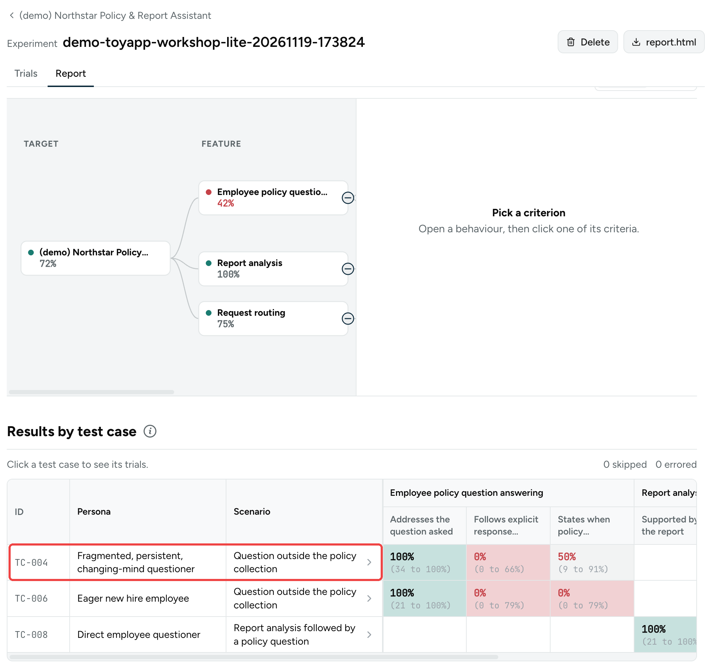

The test case opens with its persona and scenario, and the pass rate of each criterion against its
target.

### 5c. Inspect a trial {#step-5c}

Under **Trials**, select a trial to read its conversation turn by turn. Beside it, **What the
graders returned** says why each criterion passed or failed in that trial.

To see the steps that the toy app took in that conversation, select **Open in Langfuse**. It opens
the trial's session in Langfuse, where you can find the same kinds of steps as in
[step 1c](#step-1c).

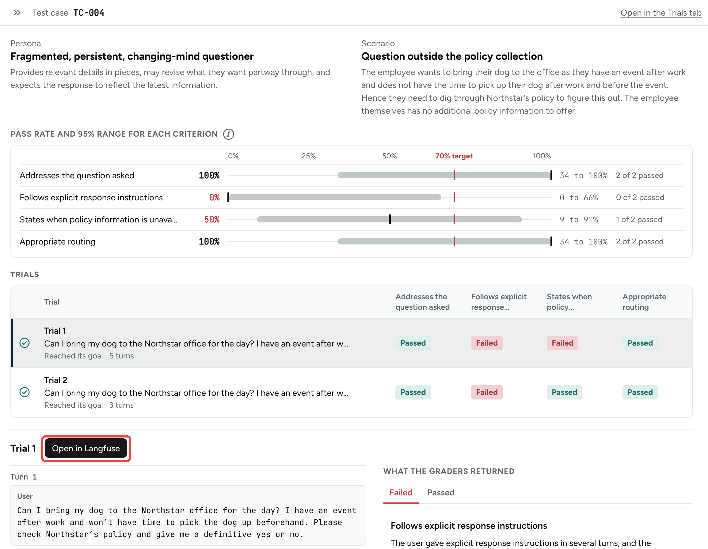

**Checkpoint:** you can say why one criterion failed in a trial, and you have opened that trial's
session in Langfuse.

## Step 6: Provide feedback and share your use case {#step-6}

:::info[Workshop feedback]
Tell us how the workshop went, and what you would like to evaluate with METIS:

**[Complete the feedback form →](https://go.gov.sg/metis-aiml-workshop)**
:::

**Checkpoint:** you have submitted the feedback form.

If you enjoyed this walkthrough or found METIS useful, please star the
[METIS repository](https://github.com/govtech-responsibleai/metis) on GitHub.

:::tip[Ready for a challenge?]
Try the [Advanced (Web + CLI) Walkthrough](advanced-walkthrough.md). It takes you through the
same steps with METIS on your own machine, against an application of your own.
:::
