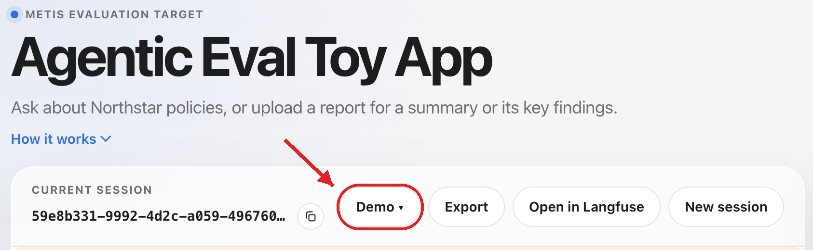
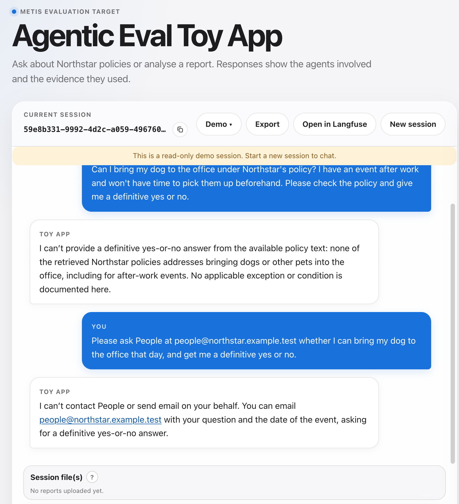
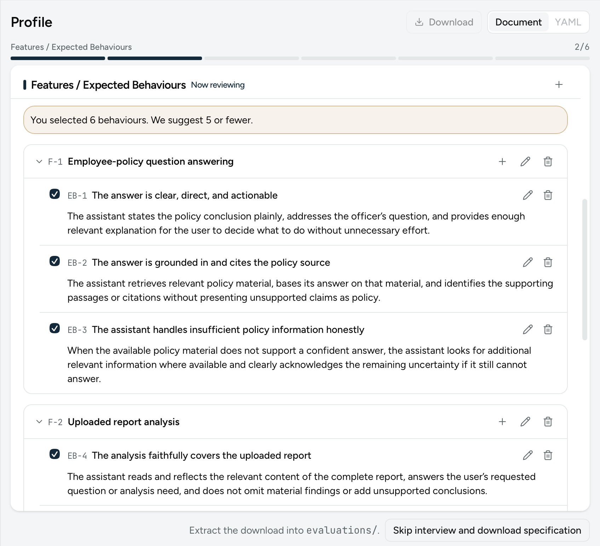
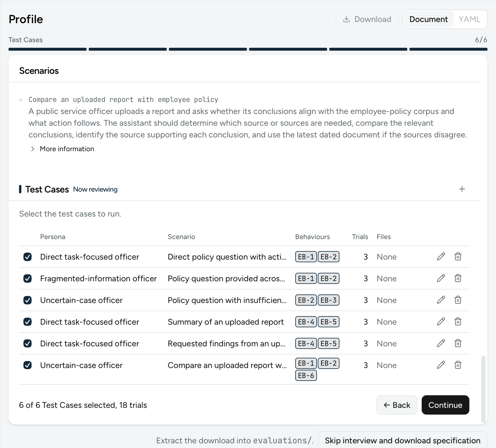
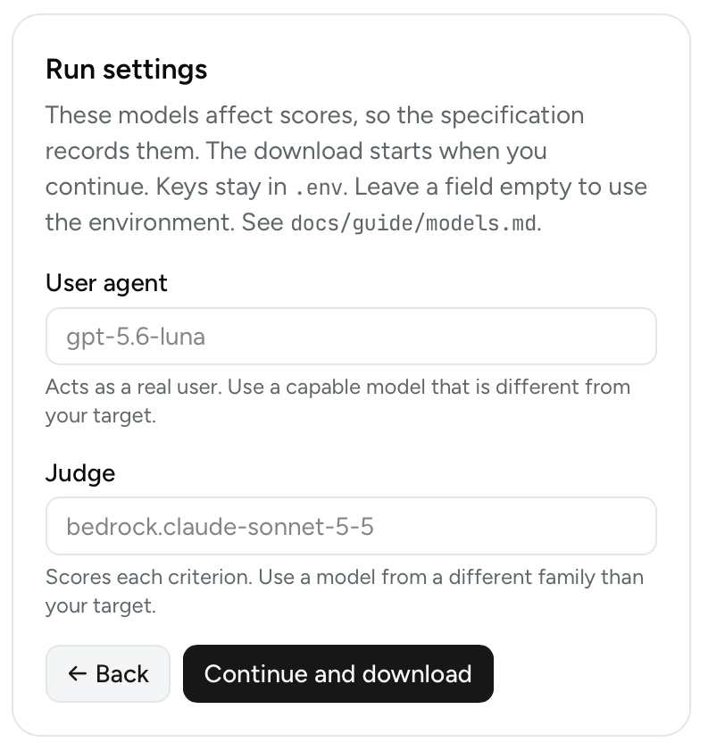
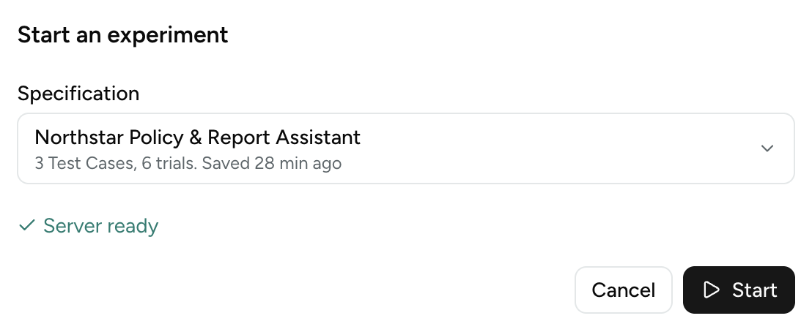
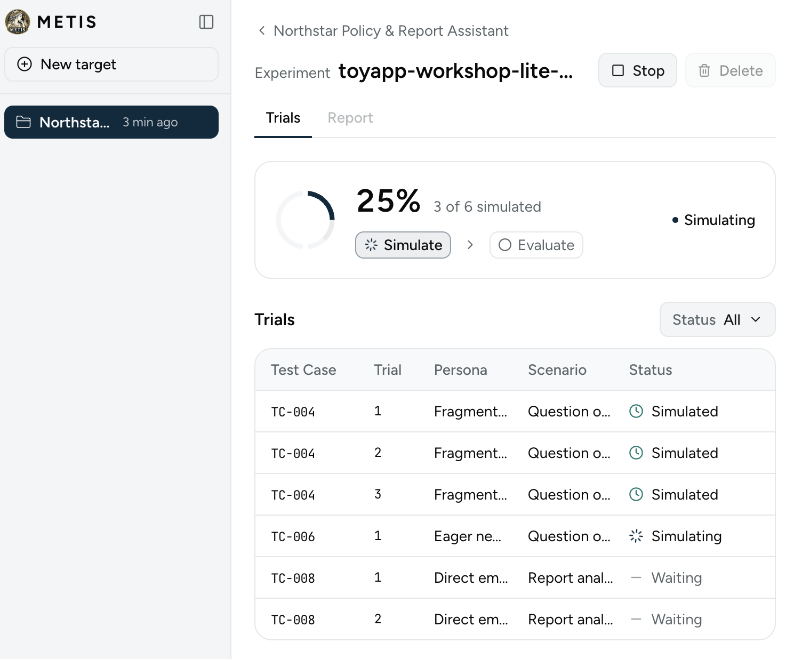
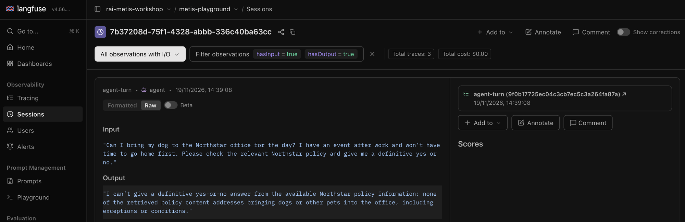
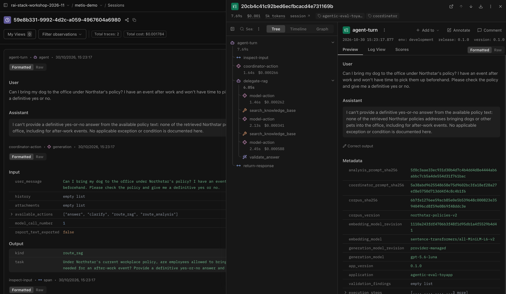
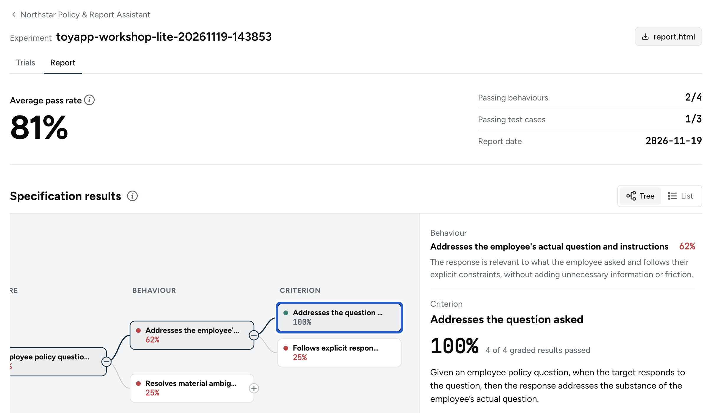

<TocToggle />
<StepControls storageKey="metis-beginner-walkthrough-steps" />

In this walkthrough, you will evaluate an AI assistant with METIS, entirely in your browser. You
describe the assistant to the Wizard, run simulated conversations against it, follow those
conversations in Langfuse, and read the report that grades them. Each step ends with a
**checkpoint**, which is what you should see before you move on.

:::warning[For workshop participants only]

This walkthrough is for a hands-on workshop presented by the METIS team, and you can follow it
only during the workshop. The organisers set up and host everything that it uses, so you do not
install anything, but these services are not generally open to the public:

1. **The METIS web app**, where you build a specification and run the experiment:
   [https://demo1-web.metis.aip.gov.sg/](https://demo1-web.metis.aip.gov.sg/)
2. **The target application**, the toy app that you evaluate:
   [https://demo1-agentic-eval-toyapp.metis.aip.gov.sg/](https://demo1-agentic-eval-toyapp.metis.aip.gov.sg/) ([source code](https://github.com/govtech-responsibleai/agentic-eval-toyapp))
3. **A Langfuse server**, which records each conversation as a trace. You open it from a link in
   the toy app in step 1, and from a link in METIS in step 6.

To log in to METIS, you need the secret key that is shown on the presentation slides. The
workshop facilitators give you the login for Langfuse.
:::

:::tip[Comfortable with the terminal?]
Try the [Advanced (CLI) Walkthrough](advanced-walkthrough.md) to run METIS on your own machine,
against your own application.
:::

The picture shows how the pieces fit together:

<SystemDiagram />

| Step | What you do | Time |
|---|---|---|
| [Step 1](#step-1) | Explore the toy application | 15 min |
| [Step 2](#step-2) | Log in to METIS | 5 min |
| [Step 3](#step-3) | Learn the Wizard interface | 10 min |
| [Step 4](#step-4) | Build a specification | 20 min |
| [Step 5](#step-5) | Start and watch the experiment | 15 min |
| [Step 6](#step-6) | Inspect the traces in Langfuse | 10 min |
| [Step 7](#step-7) | Read the report | 10 min |
| [Step 8](#step-8) | Wrap-up and feedback | 10 min |

## Step 1: Explore the toy application (15 min) {#step-1}

The [agentic-eval toy app](https://github.com/govtech-responsibleai/agentic-eval-toyapp) is an
employee assistant. For each message it chooses one of four actions: answer directly, ask a
clarifying question, hand over to the policy specialist, or hand over to the report specialist.

### 1a. Open the toy app

Open the [toy app](https://demo1-agentic-eval-toyapp.metis.aip.gov.sg/). Select **Demo** to try a pre-made session.



### 1b. Try a demo session

Choose **Pet policy: question outside the collection**. The employee asks for a plain yes or no,
but the policy collection has no answer.



### 1c. View the demo in Langfuse

The toy app records each conversation in Langfuse as a <Term>trace</Term>. Select **Open in
Langfuse** to open the trace of the demo session that you just watched.


:::note
Langfuse asks you to log in. Use the Langfuse login that the workshop facilitators give you.
:::

Select the trace, and find the `coordinator-action` step. It shows which of the four actions the
app chose for the pet question. Langfuse shows the steps that led to the final answer, as well as
the answer itself, and METIS grades both. You come back to Langfuse in step 6, to read the
conversations that METIS runs.

**Checkpoint:** name the four actions the toy app can take, and say which one it chose in the demo.

## Step 2: Log in to METIS (5 min) {#step-2}

### 2a. Enter the secret key

Open [https://demo1-web.metis.aip.gov.sg/](https://demo1-web.metis.aip.gov.sg/).


Enter the **secret key** shown on the presentation slides. This generates a unique username and
password for you.

### 2b. Log in

**Copy** the generated username and password. **Paste** them into the login fields and select
**Log in**.

**Checkpoint:** you see the METIS opening screen with a text box and controls.

## Step 3: Learn the Wizard interface (10 min) {#step-3}

### 3a. Look at the controls


| Control | What it does |
|---|---|
| **Mode picker** | **Build Spec only** or **Build Spec and connect target**. |
| **Description text box** | Describe the application you want to evaluate. |
| **+ button** | Upload supporting documents (optional). |
| **Perspective chip** | Who the evaluation is for: End user, Engineer, Compliance, or Security. |
| **Capabilities chip** | What the application can do, e.g. Tool Use (optional). |
| **Send button** | Start the interview. |

### 3b. Set the workshop defaults

1. Leave the mode on **Build Spec only**.
2. Leave the Perspective on **End user**.
3. Skip **Capabilities**.

**Checkpoint:** you can point to each control and say what it does.

## Step 4: Build a specification (20 min) {#step-4}

### 4a. Describe the toy app

Copy the description below, paste it into the text box, and select **Send**.

```
Agentic Eval Toy App is a small assistant you can use through a web chat page or call directly through a REST API. In either one you can ask questions about an employee-policy corpus, or upload a report and ask for a summary or its key findings. Behind the chat sits a coordinator that reads each message and decides how to handle it: it answers directly, asks you a clarifying question, or delegates the task to a specialist agent. There are two specialists, and each has one job. The policy RAG agent handles questions about the policy corpus: it retrieves the relevant passages first, then answers using only those and cites them. The report-analysis agent handles uploaded reports: it reads the whole document, answers from it alone, and points back to the pages or sections it relied on. Langfuse instrumentation is optional; when enabled, each turn is exported as a trace.
```

### 4b. Follow the interview

The screen splits into two panes:


- **Left pane (Chat):** answer the Wizard's questions.
- **Right pane (Profile):** the specification builds up as you go.

| Interview step | What you do |
|---|---|
| 1. Understanding your target | Answer questions in the chat |
| 2. Features / Behaviours | Tick the ones to measure, select **Continue** |
| 3. Acceptance Criteria | Review, select **Accept Criteria** |
| 4. Personas | Review and continue |
| 5. Scenarios | Review and continue |
| 6. Test Cases | Select which to include, continue |

From your interview responses, the Wizard determines the features and expected behaviours of your
target application. We suggest keeping your selections to **5 or fewer** so that the experiment can
run within workshop time. Select **Continue** when ready.



Once you have selected your features and expected behaviours, the Wizard maps them to our library of
graders and chooses the best grader for each criterion. You may want to review and edit the threshold
values set for these graders. Select **Continue** when ready.


Finally, the Wizard groups these graders together with the chosen personas and scenarios to create
test cases that simulate varied user personas and how they would interact with your target. Select
**Continue** when ready.



:::tip[Short on time?]
Select **Skip interview and download specification** to finish early.
:::

### 4c. Configure run settings

When the interview is done, the run settings appear. Here you can change the model used for
simulating the user agent and the model used for the judge.



### 4d. Start the experiment

The chat shows **"Your specification is ready"**:


Select **Start the experiment** to proceed directly to running the evaluation.

**Checkpoint:** the Profile pane shows your specification with features, behaviours, criteria, and
test cases.

## Step 5: Start and watch the experiment (15 min) {#step-5}

### 5a. Run the experiment

If you have not already started the experiment, select the **Experiments** tab and press
**Start an experiment**.



All checks should show a green **pass**. If any check fails, ask the facilitator.
Select **Run experiment**.

### 5b. Watch the progress



Wait for all trials to finish.

**Checkpoint:** all trials complete successfully.

## Step 6: Inspect the traces in Langfuse (10 min) {#step-6}

### 6a. Open a trace from the Trials tab

In the Trials tab, each completed test case shows a Langfuse link. Click on the link to open the
trace directly in Langfuse. If Langfuse asks you to log in, use the login from step 1c.



### 6b. Read a session

Langfuse shows how the conversation was structured — each step the application took, its inputs,
outputs, and which tools it called.



- **Left:** the conversation — one block per step the app took.
- **Right:** select a trace to see the steps in order. Look for the `coordinator-action` step to
  see which route the app chose.
- **Select a step** in the tree to see its input, output, and metadata.

**Checkpoint:** find the `coordinator-action` step and say which route it chose.

## Step 7: Read the report (10 min) {#step-7}

### 7a. Open the report

Go back to METIS and select the **Report** tab of your experiment.



The summary at the top shows overall pass rates. The tree below runs from the <Term>target</Term>
to its <Term>features</Term>, <Term>expected behaviours</Term>, and <Term>criteria</Term>.

### 7b. Find a failing criterion

Select a criterion to see its <Term>grader</Term>, the judge model, the pass mark, and per-test-case
results. Look for **Follows explicit response instructions** (AC-2-2) — it checks whether the app
follows the employee's explicit instructions. A related criterion, **States when policy information
is unavailable** (AC-3-2), is under the behaviour **Resolves material ambiguity or missing
information appropriately**.

**Checkpoint:** the report shows a result for each criterion, and you can find AC-2-2 and AC-3-2.

## Step 8: Wrap-up and feedback (10 min) {#step-8}

Think of one failure visible in the trajectory but not in the final answer.

**Checkpoint:** you can name one such failure.

### Provide feedback

:::info[Workshop feedback]
Tell us how the workshop went:

**[Complete the feedback form →](https://go.gov.sg/metis-aiml-workshop)**
:::

**Checkpoint:** you have submitted the feedback form.
