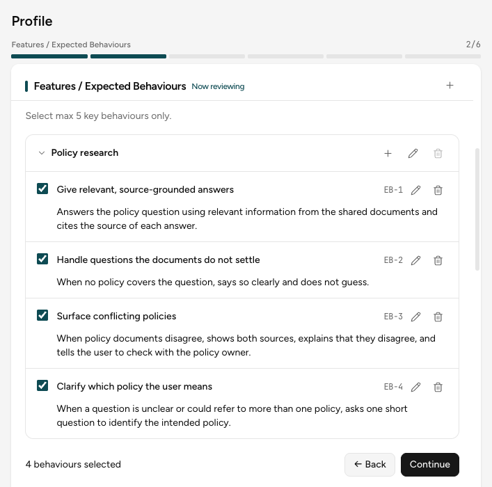
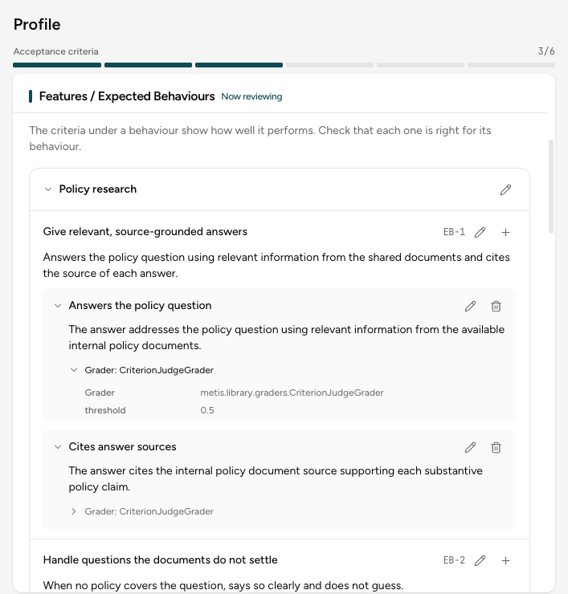
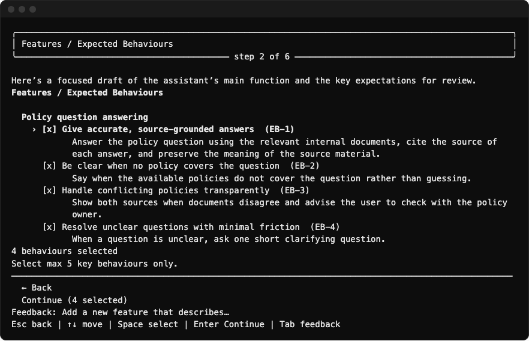

In this part of the interview, you and the Wizard write down what your application must do well,
as Features, Behaviours, and Criteria. See [The Wizard guides your specifications](wizard.md#the-wizard-guides-your-specifications).

## 1. Tell the Wizard about your target

Answer the Wizard's questions about your application. Short, specific answers give better tests.
After up to five questions, the Wizard drafts the Behaviours.

## 2. Select the key Behaviours

Select the Behaviours that you want to measure. Choose 5 or fewer.

To add, edit, or delete a Feature or a Behaviour, select **+**, the pen, or the trash icon. You can
also ask in the chat. Select **Continue**.

## 3. Edit the Criteria

The Wizard writes Criteria for each selected Behaviour and picks a grader for each one. Select
**Grader:** under a Criterion to see the grader and its settings.

To change a Criterion, select the pen. To add one, select **+** on a Behaviour. Select
**Continue**.

### When no grader fits

The Wizard picks the grader from the words of the Criterion. When no grader in the
[library](library/grader-library.md) fits, it uses the **criterion judge**, an LLM judge that follows the text of
the Criterion. So write each Criterion as one clear check.

## Go back

Each review step has **← Back**. It opens the step before, with your changes kept.

Using the CLI?

Press Space to select, Enter to continue, Tab to type a request, and Esc to go back. On the
Criteria review, press the right arrow to see the grader of a Criterion.

## Next step

[Design Test Cases](test-scenarios.md).
