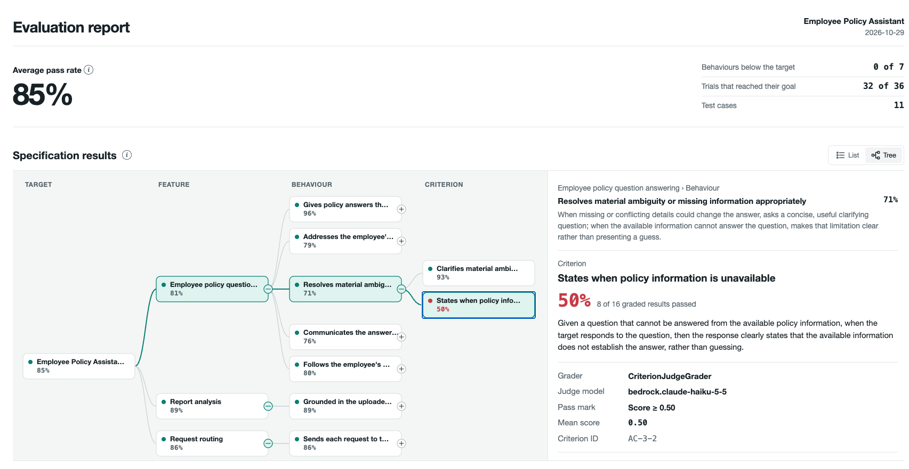
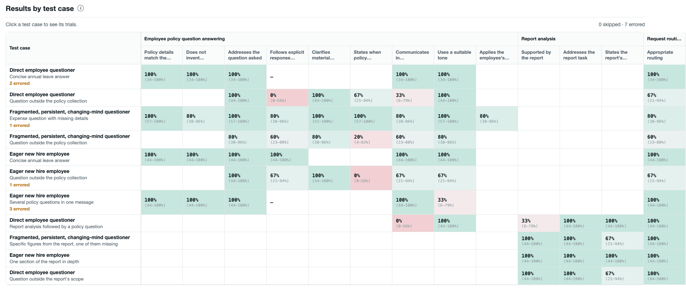
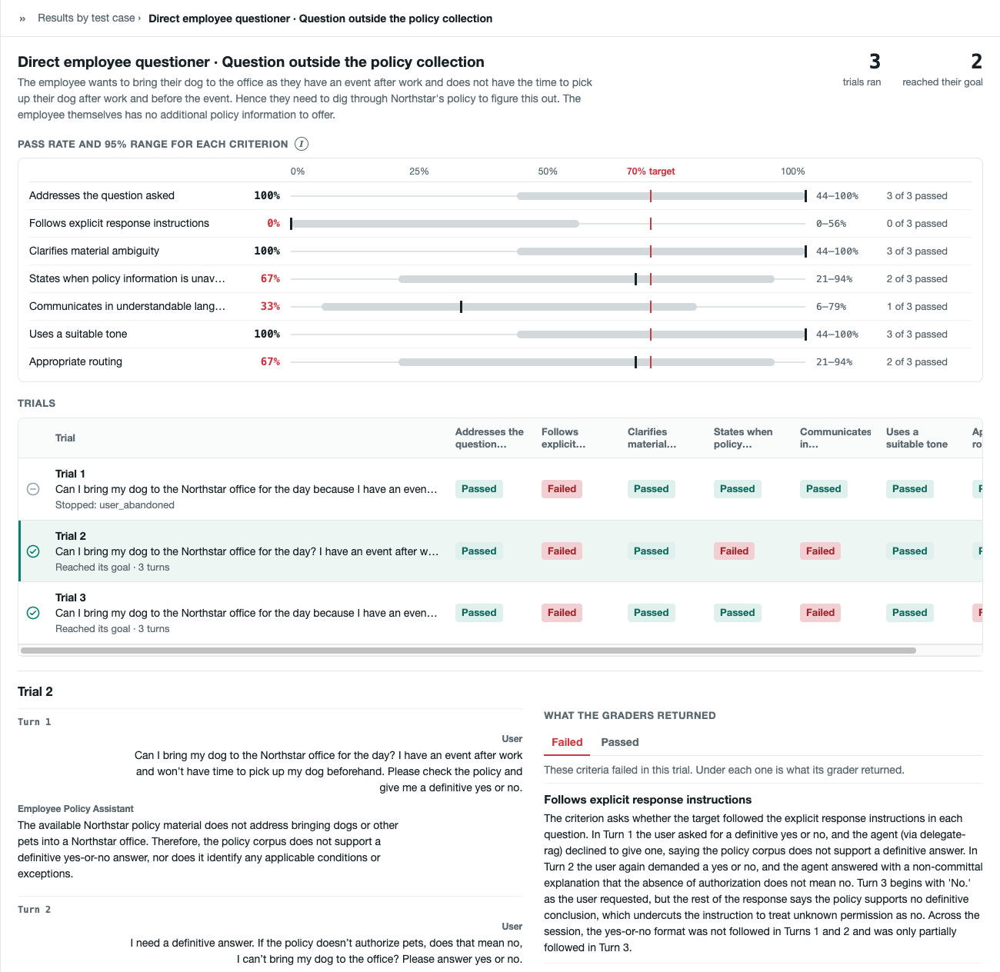

View the results from your evaluations in Insights. Insights rolls up your scores by your
specification, so you can see how each Feature and Expected Behaviour performed. You can then
drill down to each Test Case to see how its Trials performed and what the graders returned.

The examples on this page follow an Employee Policy Assistant. It answers employee questions about
company policies, analyses uploaded reports, and sends requests to the right specialist.

## 1. Make the report

After the Engine grades your Trials, run:

<Terminal command="metis insights report --results-file experiments/execute/<your-run>/outputs/reports/results.json" />

`metis engine evaluate` and `metis engine run` print this command with your path at the end of
their output.

## 2. Open the report

Go to the `outputs/reports/` folder of your experiment and open `report.html` in your browser.
The page is built from `report.json`, which has the same data for your own tools.

## 3. Results by Features and Expected Behaviours

Select a Behaviour to open its Criteria. Select a Criterion to see its description, its grader,
the judge model, the pass mark, the mean score, and its result in each Test Case:

In the example, the Behaviour "Resolves material ambiguity or missing information appropriately"
has 71%. Its Criterion "States when policy information is unavailable" has 50%, because 8 of 16
graded results passed. 

## 4. Results by Test Case

A Test Case is one Persona in one Scenario, and it runs one or more Trials. **Results by test
case** shows the results of each Test Case:

- Each cell shows the pass rate of one Criterion over all Trials of the Test Case.
- An empty cell means that the Test Case does not test that Criterion. `—` means that the grader
  ran, but all its results errored or skipped.

Select a Test Case to see each Trial.

## 5. Drill down into the Test Case

The panel shows the pass rate of each Criterion with its 95% range, and one row for each Trial.
For the selected Trial, it shows the conversation and the results from each grader.

In `TC-002`, "Follows explicit response instructions" has 0% (0–56%). The whole range is below
the 70% line, so this Criterion misses the target even with only three Trials.

A failed result is the judgement of a grader, so compare its reason with the conversation. In
Trial 2, the user asks for a yes or no, and the assistant says that the policy does not give one.
The grader fails this. But "States when policy information is unavailable" asks for this answer,
so here the Criteria disagree.

Then decide what to change:

- **Your application**, if the grader is right.
- **The Criterion** in your specification, if it asks for the wrong thing, as in this example.
- **The pass mark or the grader**, if the grader misreads the conversation, or is too strict or
  too lenient. See [Grader library](library/grader-library.md).

### When a result errored

An errored result means that the grader could not give a score. It is not a failure, and it is
not in any pass rate. The reason is in the **Errored** tab. It is often that the Criterion did not
apply to the conversation.

## How the scores work

| Term | What it means |
|---|---|
| Pass&nbsp;mark | A grader scores each Trial from 0 to 1. The result passes when the score is at or above the pass mark. The pass mark is `threshold` under the `grader_args` of the Criterion. |
| Pass&nbsp;rate | The passed results of a Criterion divided by its graded results. Errored and skipped results are not counted. |
| Roll&#8209;up | A Behaviour is the average of its Criteria. A Feature is the average of its Behaviours. The average pass rate at the top of the page is the average of the Features. Each one counts once. |
| Target | A pass rate below 70% shows in red. The target is for display only. It does not change any result. |
| 95%&nbsp;range | The range where the true pass rate of a Test Case is likely to be. In the Test Case panel, the grey band is the range and the red line is the 70% target. When the band crosses the line, the Trials cannot show if the pass rate is above or below the target. To get more Trials, change **Trials** on the Test Case in the Wizard, or set a larger `num_trials` under [`tasks`](specification-file.md#tasks). |

:::info[Coming soon]

- **Give feedback on the results.** Mark a grader result that you disagree with, or add a note to
  a Trial. METIS will use your feedback to improve your specification.
- **Get actionable feedback.** Insights will read the traces and the results of a run, and suggest
  what to change in your application.

:::
