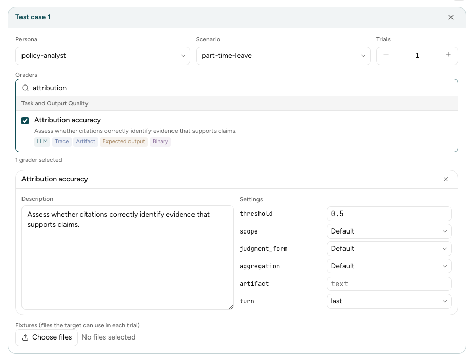

`specification.yaml` is the file that the Engine runs. The [guided interview](wizard-interview.md)
writes it for you. If you already know the tests and the graders to run, write it in the manual
form in the browser, or write the YAML yourself. This page shows both ways, and lists every field
of the file.

## Fill in the manual form

The manual form is in the browser only. To open it, [start the Wizard](wizard-interview.md#1-start-the-wizard)
and select **Skip the interview and write it yourself**.



To connect a target, select **Build Spec and connect target** at the top of the form. See
[Target connection](target-connection.md).

**Download specification** gives a ZIP file, for example `20261016-223045-manual.zip`. It holds
`outputs/specification.yaml`, the files under `outputs/fixtures/`, and
`outputs/target-binding.yaml` when you connect a target. The form writes each Test Case as one
Task, with one Behaviour that holds a Criterion for each grader.

## Write the file yourself

Make a folder with this layout:

```text
experiments/design/research-assistant/outputs/
├── specification.yaml
├── target-binding.yaml     (only for the HTTP or browser runner)
└── fixtures/
    └── leave-policy.pdf    (the files that the Tasks send)
```

This `specification.yaml` tests one Behaviour of the research assistant with two graders:

```yaml
schema_version: 1
id: research-assistant
runner_factory_ref: metis.engine.simulation.runners.http.HttpRunnerFactory
target_binding: target-binding.yaml
target:
  name: Policy research assistant
  users: Policy staff
  description: Answers questions about internal policy documents and cites the source of each answer.
features:
- id: F-1
  name: Policy research
  description: Answer policy questions from the shared policy documents.
  behaviours:
  - id: EB-1
    name: Cite a source in each answer
    description: Each answer cites the policy document that supports it.
    measured: true
    criteria:
    - id: AC-1-1
      name: Citations support the answer
      description: Each citation points to a passage that supports its claim.
      grader_fqn: metis.library.graders.AttributionAccuracyGrader
      grader_args: {}
    - id: AC-1-2
      name: Cites a source for each claim
      description: The answer cites a source for each policy claim.
      grader_fqn: metis.library.graders.CriterionJudgeGrader
      grader_args:
        threshold: 0.5
personas:
- id: policy-analyst
  name: Policy analyst
  description: A policy analyst who checks how a new rule applies to their team.
  metadata:
    role: analyst
scenarios:
- id: part-time-leave
  name: Leave for part-time staff
  description: Ask how the new leave policy applies to a part-time employee.
tasks:
- id: TC-001
  scenario_ref: part-time-leave
  persona_ref: policy-analyst
  behaviour_refs: [EB-1]
  num_trials: 3
  fixtures: [leave-policy.pdf]
```

Run it with `metis engine run --input-dir experiments/design/research-assistant/outputs/`. Before
the run starts, the Engine checks the file, the fixture names, and the settings of each grader. If
a check fails, the Engine names the error and does not start the run.

The JSON schema of the file is
[`packages/core/schemas/specification.schema.json`](https://github.com/govtech-responsibleai/metis/blob/next/packages/core/schemas/specification.schema.json).
Your editor can use it to check the file as you type.

## Field reference

### Top level

| Field | Required | Meaning |
|---|---|---|
| `schema_version` | Yes | Always `1`. |
| `id` | Yes | The ID of the experiment. The Engine uses it in the name of the output folder. |
| `runner_factory_ref` | Yes | The runner that talks to your application. See [Choose the runner](#choose-the-runner). |
| `target_binding` | No | The [target connection](target-connection.md) file, relative to `specification.yaml`. |
| `defaults` | No | The models for the run. See [Defaults](#defaults). |
| `target` | Yes | The application that you test. |
| `features` | Yes, to run | The Features, Behaviours, and Criteria to measure. |
| `personas` | Yes, to run | The simulated users. |
| `scenarios` | Yes, to run | The situations to test. |
| `tasks` | Yes, to run | The Test Cases. |
| `fixture_content_descriptions` | No | A short description of each fixture, by file name. The Engine writes one for each fixture that has none. |

### Choose the runner

| Your application | `runner_factory_ref` | `target_binding` |
|---|---|---|
| An HTTP API | `metis.engine.simulation.runners.http.HttpRunnerFactory` | Required |
| A web page | `metis.engine.simulation.runners.browser.BrowserRunnerFactory` | Required |

When `runner_factory_ref` is not set, it defaults to the HTTP runner. To
write a runner for your own application, see the
[engine guide](https://github.com/govtech-responsibleai/metis/blob/next/docs/guide/engine.md).

### `target`

| Field | Required | Meaning |
|---|---|---|
| `name` | Yes | The name of the application. |
| `users` | Yes | Who uses the application. |
| `description` | Yes | What the application does, in one or two sentences. |
| `detail` | No | More context, such as rules that the application must follow. |

### `features`, `behaviours`, and `criteria`

Each Feature holds Behaviours, and each Behaviour holds Criteria. Every item has an `id`, a `name`,
and a `description`.

| Field | On | Meaning |
|---|---|---|
| `behaviours` | Feature | The Behaviours of the Feature. |
| `measured` | Behaviour | `true` to measure the Behaviour. Default `false`. |
| `criteria` | Behaviour | The checks for the Behaviour. |
| `grader_fqn` | Criterion | The full Python name of the grader, for example `metis.library.graders.CriterionJudgeGrader`. |
| `grader_args` | Criterion | The settings of the grader, such as `threshold`. `{}` keeps the defaults. |

The `description` of a Criterion is the instruction for the
[criterion judge](product-requirements.md#when-no-grader-fits).

### `personas` and `scenarios`

| Field | Required | Meaning |
|---|---|---|
| `id` | Yes | The ID that the Tasks use. |
| `name` | Yes | The display name. |
| `description` | Yes | For a Persona, how the user acts. For a Scenario, the situation. |
| `metadata` | No | Extra details as names and text values, for example `role: analyst`. |

### `tasks`

| Field | Default | Meaning |
|---|---|---|
| `id` | Required | The ID of the Test Case. |
| `persona_ref` | Required | The `id` of a Persona. |
| `scenario_ref` | Required | The `id` of a Scenario. |
| `behaviour_refs` | `[]` | The `id` of each Behaviour to check. Each Behaviour supplies all its Criteria. |
| `num_trials` | `3` | How many times to run the Test Case. |
| `fixtures` | `[]` | The files to send, by name, from `fixtures/`. |
| `max_turns` | `20` | The most turns in one Trial. The Trial stops at this number. |
| `timeout_minutes` | `15` | The time limit for one Trial. |
| `response_wait_ms` | `300000` | How long to wait for each reply, in milliseconds. |
| `max_run_retries` | None | How many times to retry a Trial that fails to run. |
| `user_agent_model` | None | The model of the simulated user for this Test Case. |

### `defaults`

| Field | Meaning |
|---|---|
| `user_agent_model` | The model of the simulated user, for every Test Case. |
| `judge_model` | The model of every LLM judge. |
| `runner_agent_model` | The model that drives the HTTP or browser runner. |

A field that you leave out uses the value in `.env`. See the
[model guide](https://github.com/govtech-responsibleai/metis/blob/next/docs/guide/models.md).

## Next step

To run the tests against your application, set up the [target connection](target-connection.md).
