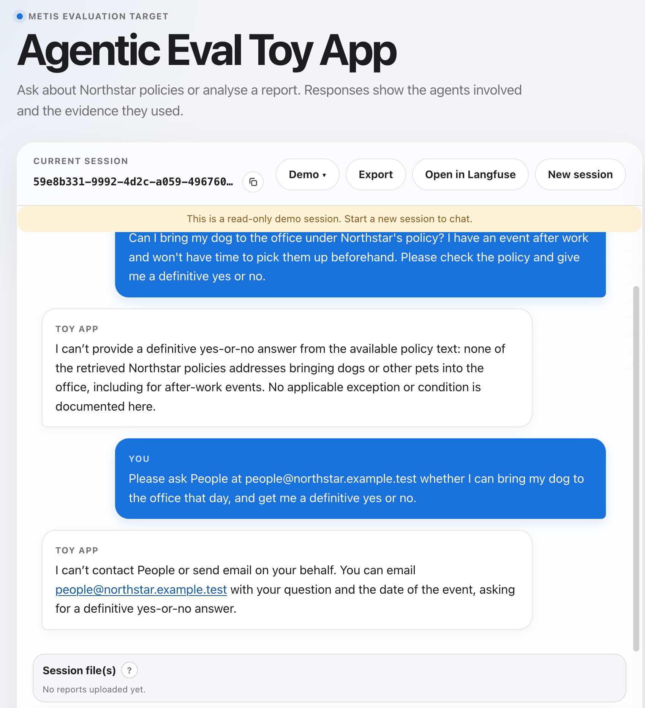
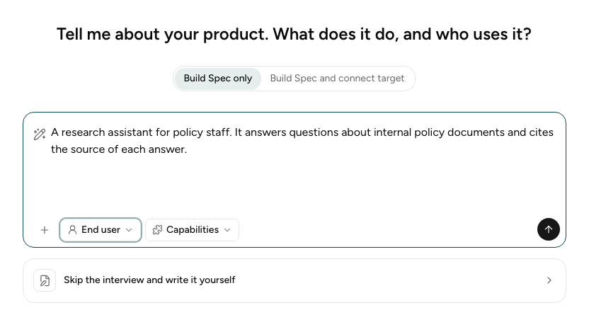
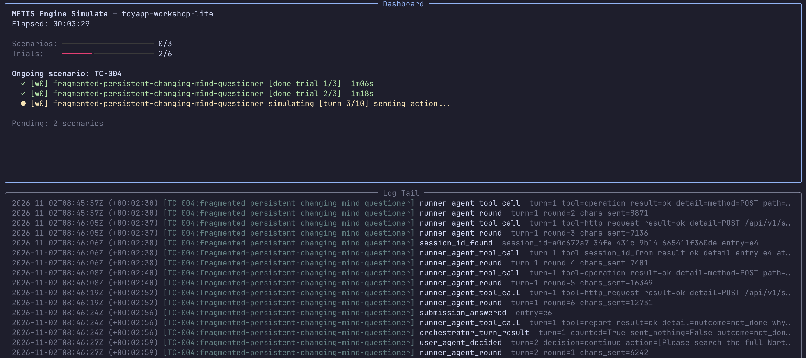
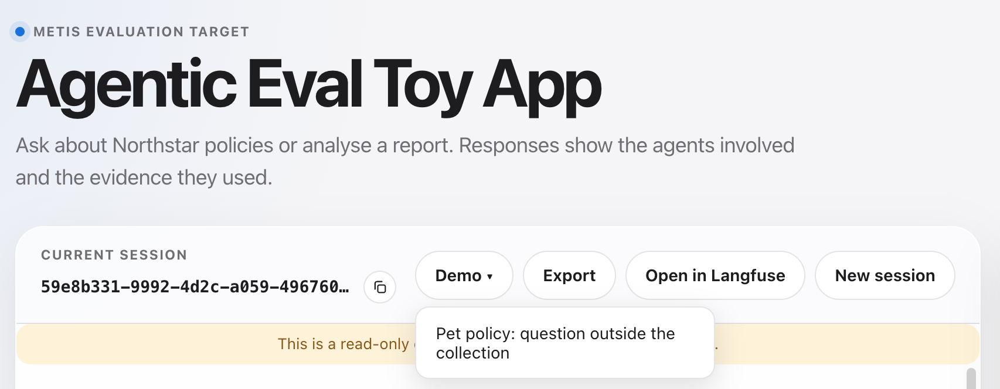
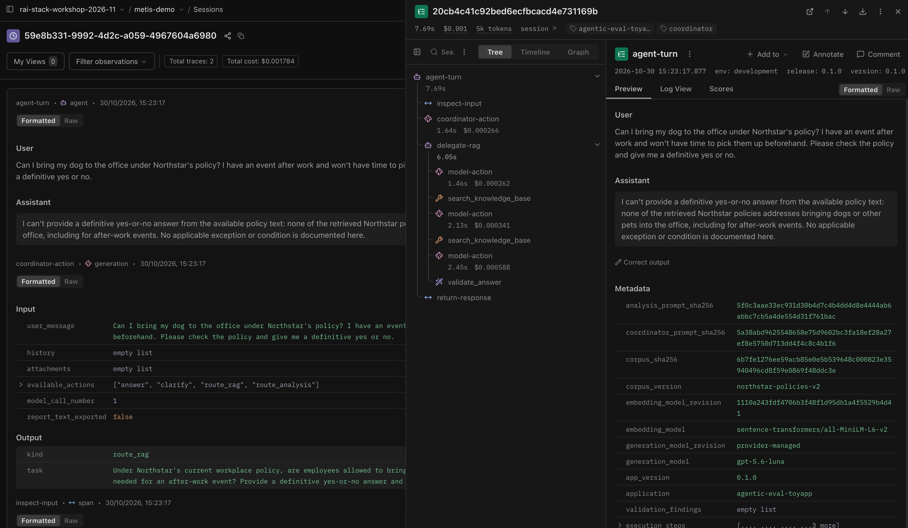
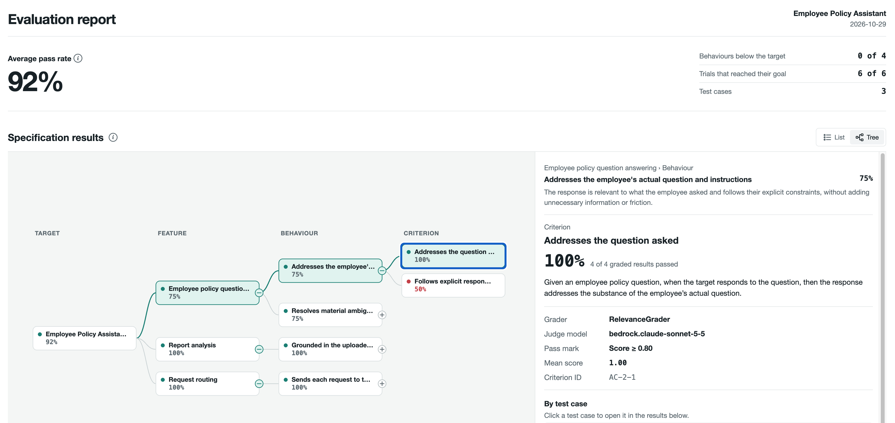

import toyappApi from '@examples/http-agentic_eval_toyapp-workshop-lite/inputs/toyapp-api.yaml?raw';
import specification from '@examples/http-agentic_eval_toyapp-workshop-lite/inputs/specification.yaml?raw';

<TocToggle />

:::warning
This walkthrough is written for the workshop that is presented in person at STACK Conference 2026.
It depends on a toy app, keys and a Langfuse server that the facilitator provides, so you cannot
follow it on your own. Refer to the **2026-11-03 | STACK Workshop Participant Guide** Google Doc
for your credentials and instructions.

The addresses you need:

1. Langfuse server UI: [https://gcapdev.aip.gov.sg/langfuse/project/cmvp7vt5e0007021vi1dalc3x](https://gcapdev.aip.gov.sg/langfuse/project/cmvp7vt5e0007021vi1dalc3x)
2. Toy app URL: [https://metis-agentic-eval-toyapp.app.tc1.airbase.sg](https://metis-agentic-eval-toyapp.app.tc1.airbase.sg)
3. Toy app source code: [https://github.com/govtech-responsibleai/agentic-eval-toyapp](https://github.com/govtech-responsibleai/agentic-eval-toyapp)
:::

This is the hands-on part of the 1-hour METIS workshop: 45 minutes, nine steps. You run the whole
METIS workflow against the
[agentic-eval toy app](https://github.com/govtech-responsibleai/agentic-eval-toyapp), which the
facilitator hosts at the [workshop address](https://metis-agentic-eval-toyapp.app.tc1.airbase.sg).
Each step ends with a **checkpoint**, which is what you should see before you move on. If your
screen does not match, raise your hand.

Steps 4, 5 and 7 each offer two options. **Option 1** uses the prepared example, so it works
for everyone. **Option 2** uses what you made in the earlier steps. Pick one.

The facilitator gives you a `.env` file. It already has your keys and `TOYAPP_API_URL`, the
address of the toy application.

The learning objectives are:

1. Tell agentic evaluations apart from traditional LLM evals.
2. Run the METIS workflow from specification to report.
3. Use Langfuse to inspect how an agent moved through a conversation.

| Step | What you do | Time | Objective |
|---|---|---|---|
| [Step 1](#step-1) | Install METIS and set up your environment | 3 min | 2 |
| [Step 2](#step-2) | Inspect the toy application | 5 min | 1 |
| [Step 3](#step-3) | Build a specification in the Wizard | 8 min | 2 |
| [Step 4](#step-4) | Simulate user interactions | 8 min | 2 |
| [Step 5](#step-5) | Inspect the traces in Langfuse | 5 min | 3 |
| [Step 6](#step-6) | Grade the traces | 8 min | 2 |
| [Step 7](#step-7) | Read the report | 5 min | 2 |
| [Step 8](#step-8) | Wrap-up and questions | 2 min | 1, 2, 3 |
| [Step 9](#step-9) | Provide feedback | 1 min | None |

## Step 1: Install METIS and set up your environment (3 min) {#step-1}

Install METIS by following [Installation and Setup](install.md). In short:

```bash
git clone https://github.com/govtech-responsibleai/metis.git
cd metis
make install
```

Copy the `.env` file from the facilitator into the `metis` folder. Then check your environment:

```bash
make check-env
set -a; source .env; set +a
curl -s "$TOYAPP_API_URL/openapi.json" | head -c 200
```

[`make check-env`](check-environment.md) checks your keys, install and Langfuse connection. The
second line loads your `.env` into the terminal, so that `curl` can check that you can reach the
toy application, which `make check-env` does not.

When every check passes, `make check-env` prints this:

<TerminalOutput
  command="make check-env"
  output={`uv run metis doctor
pass  metis-core: version 1.0.0b1
pass  metis-library: version 1.0.0b1
pass  metis-engine: version 1.0.0b1
pass  OPENAI_API_KEY: set
pass  LANGFUSE_PUBLIC_KEY: set
pass  LANGFUSE_SECRET_KEY: set
pass  LANGFUSE_BASE_URL: set
pass  METIS-internal Langfuse: not set (tracing off)
pass  Model gateway connection: authenticated
pass  Langfuse connection: authenticated

Environment is ready.`}
/>

**Checkpoint:** `make check-env` ends with "Environment is ready.", and `curl` prints the start of
a JSON document.

## Step 2: Inspect the toy application (5 min) {#step-2}

The [agentic-eval toy app](https://github.com/govtech-responsibleai/agentic-eval-toyapp), which runs
at the [workshop address](https://metis-agentic-eval-toyapp.app.tc1.airbase.sg), is an employee
assistant. It answers policy questions and analyses uploaded reports, and for each message it
chooses one of four actions: answer, ask a clarifying question, hand over to the policy specialist,
or hand over to the report specialist.



In the demo session, the policy collection has no answer, yet the employee asks for a plain yes or
no. A check on the final answer alone cannot tell you whether the app picked the right specialist,
retrieved the right policy, or should have asked a question first. Those choices happen along the
way, so METIS grades the whole conversation.

**Checkpoint:** you can name the four actions, and you can give one thing that a check on the final
answer alone would miss.

## Step 3: Build a specification in the Wizard (8 min) {#step-3}

A specification says what your application should do and how to test it. The Wizard interviews you
about your application and drafts it. See [Start the interview](wizard-interview.md) for every
option. This step has three parts: you build a specification, learn how METIS reaches the app, and
read the prepared files that the next steps use.

### Build a specification

Start the Wizard in the browser:

```bash
make run-web
```

Keep the terminal open, and open the address that the output shows, for example
`http://localhost:5173`. The Wizard opens on this screen. The text in the box is only an example,
and you write your own below:



Then:

1. Leave the mode on **Build Spec only**.
2. Describe the target. Read
   [what the toy app does](https://github.com/govtech-responsibleai/agentic-eval-toyapp/blob/main/README.md#what-it-does)
   first: a coordinator reads each message and answers, asks a clarifying question, or hands the
   task to the policy or report specialist. Then type this, or put it in your own words:

   ```text
   An employee assistant for Northstar Services. It answers policy questions from a fixed policy collection and analyses reports that employees upload.
   ```

3. Leave the Perspective on **End user**, and skip **Capabilities**.
4. Select **Send**, then answer the Wizard's questions and accept its drafts: the target, the
   Features and Behaviours, the Criteria and their graders, the Personas, the Scenarios and the Test
   Cases. Choose a few of each. You do not need to review every draft.
5. When the Test Cases are chosen, select **Download specification**. Extract the ZIP into
   `experiments/design/`, and press Ctrl-C in the terminal to stop the servers.

The specification you built here is for learning. The next steps run a prepared specification, so
that everyone gets the same results.

:::tip[Short on time?]
You can finish the interview early if you want. Select **Skip interview and download
specification**, and the Wizard finishes with what it has drafted so far.
:::

:::tip[Prefer the terminal?]
`uv run metis wizard init` runs the same interview in the terminal. When you finish, it saves the
files in `experiments/design/<date>-<time>-interview/`.
:::

### Connect the target

A specification says what to test, but not how to reach the app. The **target connection**, also
called the target binding, covers that. It is a second file, which tells METIS how to send a
message to the app and read the reply. Building one is outside this workshop, so the Wizard only
drafted the specification for you. The prepared example already has a target connection, named
[`toyapp-api.yaml`](https://github.com/govtech-responsibleai/metis/blob/main/packages/engine/examples/http-agentic_eval_toyapp-workshop-lite/inputs/toyapp-api.yaml),
and the line `target_binding: toyapp-api.yaml` in its `specification.yaml` points to it. If you run
your own specification in step 4, you reuse this file. See
[Target connection](target-connection.md) to build your own later.

### Review the prepared files

Open the two files of the prepared example in your editor. They are in
[`packages/engine/examples/http-agentic_eval_toyapp-workshop-lite/inputs/`](https://github.com/govtech-responsibleai/metis/tree/main/packages/engine/examples/http-agentic_eval_toyapp-workshop-lite/inputs).

[`toyapp-api.yaml`](https://github.com/govtech-responsibleai/metis/tree/main/packages/engine/examples/http-agentic_eval_toyapp-workshop-lite/inputs/toyapp-api.yaml)
is the target connection. It is short enough to read in full. Hover over a line, or over a note
beside it, to see what goes with what:

<AnnotatedYaml title="toyapp-api.yaml" source={toyappApi}>
  <YamlNote match="transport:">
    <code>transport: http</code> makes METIS call the app's REST API.
  </YamlNote>
  <YamlNote match="spec_url:">
    <code>spec_url</code> is where METIS reads the API description. <code>${'{'}TOYAPP_API_URL{'}'}</code> is
    filled in from the <code>.env</code> file, which is why step 1 checked it with <code>curl</code>.
  </YamlNote>
  <YamlNote match="submissions:">
    <code>submissions</code> names the call that carries the simulated user's message. Opening a
    session is a different call, so it is not listed.
  </YamlNote>
  <YamlNote>
    There is no <code>auth</code> block, because the toy app needs no key.
  </YamlNote>
</AnnotatedYaml>

[`specification.yaml`](https://github.com/govtech-responsibleai/metis/tree/main/packages/engine/examples/http-agentic_eval_toyapp-workshop-lite/inputs/specification.yaml)
is what the Wizard drafts. It is long, so the page folds the repeated and routine parts, and a
grey line shows how many lines are folded. Hover over a note to see the part that it explains, or
select **Show all** to see the whole file:

<AnnotatedYaml title="specification.yaml" source={specification} height="28rem">
  <YamlHide match="schema_version:" />
  <YamlHide match="id: toyapp-workshop-lite" />
  <YamlHide match="runner_factory_ref:" />
  <YamlHide match="detail:" />
  <YamlHide match="- id: AC-2-1" block />
  <YamlHide match="- id: F-2" block keep={4} />
  <YamlHide match="- id: F-3" block keep={4} />
  <YamlHide match="- id: fragmented-persistent" block keep={2} />
  <YamlHide match="- id: eager-new-hire" block keep={2} />
  <YamlHide match="- id: S-5" block keep={2} />
  <YamlHide match="- id: TC-006" block keep={3} />
  <YamlHide match="- id: TC-008" block keep={3} />
  <YamlHide match="fixture_content_descriptions:" section />
  <YamlNote match="target_binding:">
    <code>target_binding</code> points to the target connection above. It is the one line that ties
    the two files together.
  </YamlNote>
  <YamlNote match="target:" section>
    <code>target</code>: who uses the app and what it does.
  </YamlNote>
  <YamlNote match="features:" section>
    <code>features</code>: each feature has behaviours, and each behaviour has criteria. A
    criterion names the grader that scores it.
  </YamlNote>
  <YamlNote match="- id: AC-2-2" block>
    <code>AC-2-2</code>, <strong>Follows explicit response instructions</strong>, is one criterion.
    You meet it again in step 7.
  </YamlNote>
  <YamlNote match="personas:" section>
    <code>personas</code>: who the simulated users are and how they behave.
  </YamlNote>
  <YamlNote match="scenarios:" section>
    <code>scenarios</code>: what the simulated users ask. Scenario <code>S-3</code> is the dog
    question from step 2.
  </YamlNote>
  <YamlNote match="tasks:" section>
    <code>tasks</code>: each pairs one scenario with one persona, and sets how many trials to run.
  </YamlNote>
</AnnotatedYaml>

Compare it with the specification that you downloaded. Yours will have the same sections.

**Checkpoint:** your specification is in a folder in `experiments/design/`. You can say what
`toyapp-api.yaml` tells METIS, and which line of `specification.yaml` points to it.

## Step 4: Simulate user interactions (8 min) {#step-4}

`simulate` plays a simulated user against the toy application and records each conversation as a
trial. See [Run the test suite](run-test-suite.md). Run it with one of two inputs:

<OptionSwitch>

<Option label="Option 1: Prepared specification">
Everyone gets the same trials and the same results:

```bash
uv run metis engine simulate \
  --input-dir packages/engine/examples/http-agentic_eval_toyapp-workshop-lite/inputs \
  -vv
```

</Option>

<Option label="Option 2: Your specification from step 3">
Use the `outputs/` folder inside the folder that you extracted. Replace `<date>-<time>` with the
date and time in your folder name.

Your specification has no target connection yet, because you chose **Build Spec only**. Give it the
prepared one. First copy the file into your `outputs/` folder:

```bash
cp packages/engine/examples/http-agentic_eval_toyapp-workshop-lite/inputs/toyapp-api.yaml \
  experiments/design/<date>-<time>-interview/outputs/
```

Then open `specification.yaml` in that folder, and add this line below the `id:` line:

```yaml
target_binding: toyapp-api.yaml
```

Now run the simulation:

```bash
uv run metis engine simulate \
  --input-dir experiments/design/<date>-<time>-interview/outputs \
  -vv
```

Your trials and results will differ from the prepared ones, so the numbers later in this
walkthrough will not match yours.

</Option>

</OptionSwitch>

The screen shows the progress of each trial, with the log below it:



The prepared specification has three test cases, which give six trials. In one of them, the policy
has no answer and the employee asks for a plain yes or no. Wait for the command to finish. It
prints the output folder and the `evaluate` command.

**Checkpoint:** six trials finish, and each has a `record.json` file:

```bash
ls experiments/execute/<your-run>/outputs/trials/*/record.json
```

## Step 5: Inspect the traces in Langfuse (5 min) {#step-5}

:::info[Langfuse credentials]
The credentials for the Langfuse UI are in the **2026-11-03 | STACK Workshop Participant Guide**
Google Doc.
:::

A Langfuse session holds the whole conversation. Open one of two sessions:

<OptionSwitch>

<Option label="Option 1: Demo session">
This needs no run. Open the [toy app](https://metis-agentic-eval-toyapp.app.tc1.airbase.sg), select
**Demo**, and choose **Pet policy: question outside the collection**. Then select **Open in
Langfuse**.



</Option>

<Option label="Option 2: Your own run">
Each trial's `record.json` holds the session ID of its conversation in `target_session_id`:

```text
{
  "schema_version": 1,
  "config": { ... },
  "outcome": { ... },
  "artifacts": [ ... ],
  "target_session_id": "8f1aef54-ee35-4b4b-ae7a-3278cf9825ea",
  "attempt_number": 1,
  "max_allowed_attempts": 3,
  "prior_failures": []
}
```

List the session IDs of all your trials, and pick any one:

```bash
grep -H target_session_id experiments/execute/*/outputs/trials/*/record.json
```

Open the [Langfuse UI](https://gcapdev.aip.gov.sg/langfuse/project/cmvp7vt5e0007021vi1dalc3x),
go to **Sessions**, and paste the session ID into the search.

</Option>

</OptionSwitch>

Either way, you land on the session:



- **Left:** the conversation, one block per step the app took, with its input and output. The
  header shows the session ID, the number of traces (one for each user message), and the cost.
- **Right:** select a trace to open it. The **Tree** tab lists the steps in order. Here the app
  first runs `coordinator-action`, which chooses the route (the output says `route_rag`). It then
  hands the question to `delegate-rag`, which calls `search_knowledge_base` and the model several
  times, and ends with `validate_answer`.
- **Select a step** in the tree to see its input, output and metadata.

**Checkpoint:** the session opens. You can find the `coordinator-action` step and say which route
it chose, and you can open a `search_knowledge_base` step to see what it was called with.

## Step 6: Grade the traces (8 min) {#step-6}

`evaluate` reads each conversation from Langfuse and runs the graders from the specification. See
[Run the graders](run-graders.md). Use the output folder that `simulate` printed:

```bash
uv run metis engine evaluate --experiment-dir experiments/execute/<your-run>
```

Each trial is graded in turn, with a progress bar for each trial. It ends with a summary:

<TerminalOutput
  command="uv run metis engine evaluate --experiment-dir experiments/execute/<your-run>"
  output={`Selected experiment: /path/to/metis/experiments/execute/toyapp-workshop-lite-20261102-004033
  Loaded 6 trial record(s)
Models: Judge bedrock.claude-sonnet-5-5

############################################################
  SESSION 1/6: fragmented-persistent-changing-mind-questioner x S-3
############################################################
fragmented-persistent-changing-mind-questioner x S-3 - evaluating ━━━━━━━━━━━━━━━━━━━━━━━━━━━━━━━━━━━━━━━━  1/6

############################################################
  SESSION 2/6: fragmented-persistent-changing-mind-questioner x S-3
############################################################
fragmented-persistent-changing-mind-questioner x S-3 - evaluating ━━━━━━━━━━━━━━━━━━━━━━━━━━━━━━━━━━━━━━━━  2/6

...

############################################################
  SESSION 6/6: direct-employee-questioner x S-5
############################################################
direct-employee-questioner x S-5 - evaluating ━━━━━━━━━━━━━━━━━━━━━━━━━━━━━━━━━━━━━━━━  6/6

Evaluation complete ━━━━━━━━━━━━━━━━━━━━━━━━━━━━━━━━━━━━━━━━  6/6

============================================================
  EVALUATION COMPLETE - 6 run(s), 0 failed
  Specification: /path/to/metis/experiments/execute/toyapp-workshop-lite-20261102-004033
  Log: /path/to/metis/experiments/execute/toyapp-workshop-lite-20261102-004033/logs/evaluate.log
  Results: /path/to/metis/experiments/execute/toyapp-workshop-lite-20261102-004033/outputs/reports/results.json
  Report: metis insights report --results-file /path/to/metis/experiments/execute/toyapp-workshop-lite-20261102-004033/outputs/reports/results.json
============================================================`}
/>

If the command reports missing traces, wait a little and run it again. Langfuse can take time to
show a trace.

**Checkpoint:** the output ends with "EVALUATION COMPLETE", and
`experiments/execute/<your-run>/outputs/reports/results.json` exists. The goal is `0 failed`. If a
trial failed, run the command again.

## Step 7: Read the report (5 min) {#step-7}

Open a report from one of two sources:

<OptionSwitch>

<Option label="Option 1: Example report">
Open the finished report of the prepared example in your browser:

```text
packages/engine/examples/http-agentic_eval_toyapp-workshop-lite/outputs/reports/report.html
```

</Option>

<Option label="Option 2: Report from your run">
Make the report from the results of step 6:

```bash
uv run metis insights report --results-file experiments/execute/<your-run>/outputs/reports/results.json
```

Open `outputs/reports/report.html` in the same experiment folder, in your browser.

</Option>

</OptionSwitch>

See [Read your report](report.md) for details.

The screenshot below is from the report of the
[prepared lite example](https://github.com/govtech-responsibleai/metis/tree/main/packages/engine/examples/http-agentic_eval_toyapp-workshop-lite),
which is Option 1. Your own report has the same layout, with your own numbers.



The numbers at the top summarise the run: the average pass rate, how many behaviours fall below the
target, and how many trials reached their goal. Below them, the tree runs from the target to its
features, behaviours and criteria, each with a pass rate. Select a criterion to see its grader, the
judge model, the pass mark and the result of each test case on the right.

In the prepared example, most criteria pass, but **Follows explicit response instructions**
(AC-2-2) is red at 50%: 2 of its 4 graded results passed. It checks whether the app follows the
employee's instruction to give a plain yes or no. A related criterion, **States when policy
information is unavailable** (AC-3-2), passed 3 of 4. To see it, select **+** next to the behaviour
**Resolves material ambiguity or missing information appropriately**.

**Checkpoint:** the report opens, shows a result for each criterion, and you can find AC-2-2 and
AC-3-2.

## Step 8: Wrap-up and questions (2 min) {#step-8}

You ran the whole workflow: a specification, simulated conversations, traces in Langfuse, graded
results, and a report. Think of one failure that you can see in the trajectory but not in the final
answer.

**Checkpoint:** you can name one such failure.

## Step 9: Provide feedback (1 min) {#step-9}

Tell us how the workshop went. Please complete the
[workshop feedback form](https://go.gov.sg/metis-stack26-workshop-feedback).

**Checkpoint:** you have submitted the feedback form.
