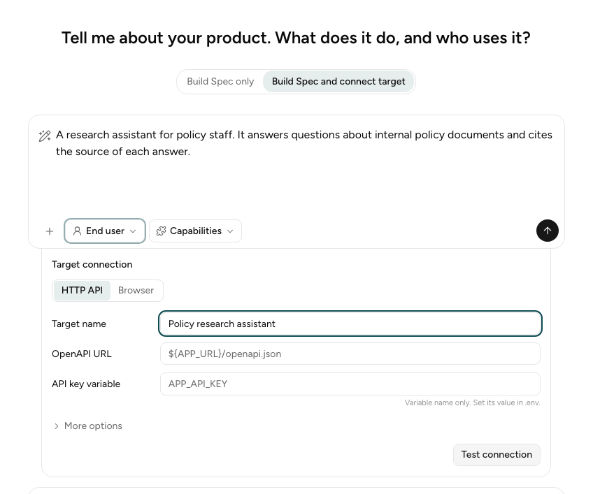

import Tabs from '@theme/Tabs';
import TabItem from '@theme/TabItem';

The **Target connection** tells the Engine how to reach your Target. METIS saves it as
`target-binding.yaml`, next to `specification.yaml`. You only need it if you wish to run your
evaluations against the Target.

## Why connect your Target

The specification defines what to test in the Target system, and how. The Engine needs to connect
to your Target to simulate a user interaction on your real application. A runner carries each
message to the Target and reads the reply, and the Engine records every step for the Graders.

## Connection Options

| | HTTP API | Browser |
|---|---|---|
| Choose it if | Your Target has an API with an OpenAPI description | Users reach your Target only through a web page |
| How the runner reaches it | It calls the API endpoints that the OpenAPI description lists | It opens the page, then clicks and types like a user |
| What you give | The OpenAPI URL and the API key variable | The start page URL and the sign-in steps |
| What you can also set | The calls that send a message, the calls to refuse, and secret headers | The variables that the sign-in steps use |

We recommend **HTTP API** as it is faster and more stable.

## Connect in the browser

Choose **Build Spec and connect target**, fill in the **Target connection** card, then select
**Test connection**.



You may also connect after the interview with **Connect target**. In the CLI, choose **Build Spec
and Run Evals (connect the target)**, or run `metis wizard connect --out-dir <folder>` later.

## Keep secrets in `.env`

Type only the name of each secret, such as `APP_API_KEY`, and set its value in `.env`:

```dotenv
APP_URL=https://policy-assistant.example.com
APP_API_KEY=your-api-key
```

The Engine fills in each `${NAME}` from `.env` when it runs.

## Write the file yourself

Put `target-binding.yaml` next to `specification.yaml`, and set `target_binding:
target-binding.yaml` in the specification. See
[Choose the runner](specification-file.md#choose-the-runner).

<Tabs groupId="target-kind">
<TabItem value="http" label="HTTP API" default>

```yaml
schema_version: 1
identity:
  name: Policy research assistant
transport: http
spec_url: ${APP_URL}/openapi.json
auth:
  secret_env: APP_API_KEY
submissions:
- POST /chat
forbidden_calls:
- DELETE /**
```

</TabItem>
<TabItem value="browser" label="Browser">

```yaml
schema_version: 1
identity:
  name: Policy research assistant
transport: browser
start_url: ${APP_URL}/login
login:
  note: Type {{secret:APP_USER}} in the email box and {{secret:APP_PASSWORD}} in the password box. Select Sign in.
  secrets: [APP_USER, APP_PASSWORD]
```

</TabItem>
</Tabs>

The JSON schema is in
[`target-binding.schema.json`](https://github.com/govtech-responsibleai/metis/blob/next/packages/core/schemas/target-binding.schema.json).

## Field reference

**Browser field** is the matching field in the **Target connection** card.

### Both transports

| Field | Browser field | Meaning |
|---|---|---|
| `schema_version` | None | Always `1`. Required. |
| `identity.name` | **Target name** | The name of the application. Required. |
| `identity.version` | None | The version of the application. |
| `transport` | **HTTP API** or **Browser** | `http` or `browser`. Required. |
| `advice.notes` | **Runner notes** | Advice for the runner, for example "The chat replies after a few seconds." |
| `advice.limits` | None | The rate limits of the application: `submit_per_minute`, `read_per_minute`, and a `note`. |

### HTTP API

| Field | Browser field | Meaning |
|---|---|---|
| `spec_url` | **OpenAPI URL** | The address of the OpenAPI description. Required. |
| `auth.secret_env` | **API key variable** | The variable that holds the API key. The Engine uses the security scheme that the OpenAPI description declares. |
| `submissions` | **Submissions** | The calls that send the user's message. If you leave it empty, the Engine uses any `POST`, `PUT`, or `PATCH` call with a JSON body. |
| `forbidden_calls` | **Refused calls** | The calls that the Engine never sends. |
| `secret_headers` | **Secret headers** | Headers that the Engine adds to matching calls. Each one has a `match` call, a `header` name, and the `env` variable of its value. |
| `tls_verify` | **Verify the TLS certificate** | `false` to skip the certificate check. Default `true`. |
| `preflight_reads` | None | Paths that the Engine reads before each Trial. A failed read is a warning only. |

Write a call as a method and a path, for example `POST /chat`. In the path, `*` matches one part,
and `**` matches any number of parts. `DELETE /**` matches every `DELETE` call.

### Browser

| Field | Browser field | Meaning |
|---|---|---|
| `start_url` | **Start page URL** | The page that the browser opens first. Required. |
| `login.note` | **Sign-in steps** | How to sign in, in plain words. Write `{{secret:NAME}}` where a secret is typed. |
| `login.secrets` | **Sign-in variables** | Each variable that the sign-in steps use. |

## Next step

Go back to the [guided interview](wizard-interview.md#3-describe-your-target), or
[run your evaluations](run-evaluation.md).
