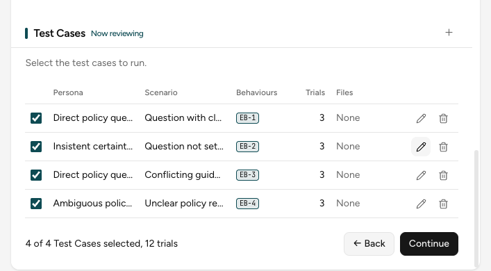

In this part of the interview, you decide how to test the Behaviours. The Wizard drafts the
simulated users and the situations. Then it pairs them into Test Cases. The examples continue the
research assistant from the [guided interview](wizard-interview.md).

## 1. Build your test cases

The Wizard drafts each part of the Test Cases, one review at a time. Check each part, then select
**Continue**.

After the Wizard drafts the Test Cases, the web client shows them in a table:



In the CLI, you review the same Test Cases as a list. When you finish, the CLI saves the files in
`experiments/design/<date>-<time>-interview/`, with a short summary in `outputs/review.md`.

| Part | What it is | What you do |
|---|---|---|
| Persona | A simulated user who talks to your application | Edit or delete a Persona that does not match your real users, or select **+** to add one |
| Scenario | A situation to test | Make sure that the Scenarios cover the hard cases, such as a question that no policy answers |
| Fixtures | Files that a Test Case sends to your application, such as a policy document | Select the pen, then **Add file** in the **Files** cell |
| Trials | How many times a Test Case runs. The default is 3, so that one unusual run does not decide the result. | Select the pen and change the number |

Each Test Case links to the Expected Behaviours that it checks. If a selected Behaviour has no Test
Case, the review names it. Add a Test Case for it before you continue. To leave a Test Case out,
clear its checkbox.

## 2. Download the specification

The chat shows **Your specification is ready**. Select **Download specification** at the bottom
of the Profile.

The browser downloads a ZIP file, for example `20261016-223045-interview.zip`. Extract it into
`experiments/design/` in the repository folder:

```text
experiments/design/20261016-223045-interview/
├── inputs/
│   └── interview_state.json
└── outputs/
    ├── specification.yaml
    ├── target-binding.yaml   (only when you connect the target)
    └── fixtures/             (the files that the Test Cases send)
```

`specification.yaml` is the file that the Engine runs. To read or change its fields, see
[Write your own specification](specification-file.md). `interview_state.json` keeps the interview, so you do
not need to open it.

### Finish early

To finish before the last step, select **Skip interview and download specification**. The Wizard
drafts the remaining steps without asking you. Then, on **Run settings**, enter the models for
the **User agent** and the **Judge**, or leave the fields empty to use `.env`. Select **Continue
and download**.

If the Wizard says "I couldn't finish this into a runnable evaluation on my own", continue the
interview step by step.

## Next step

Run the specification with the Engine:

```bash
metis engine run --input-dir experiments/design/20261016-223045-interview/outputs/
```

Replace `20261016-223045` with the date and time in your folder name. See
[Run your evaluations](run-evaluation.md).
