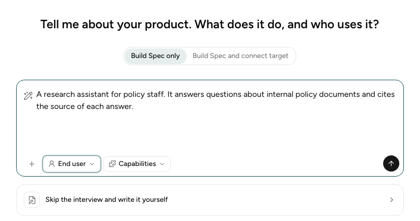
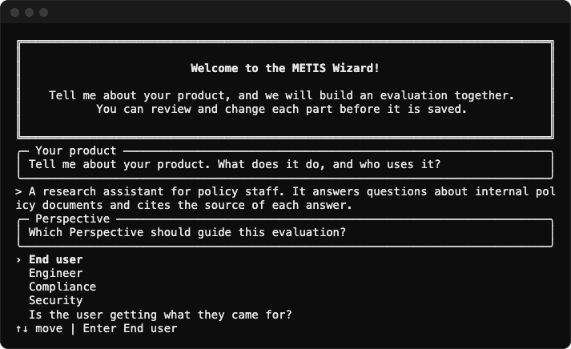
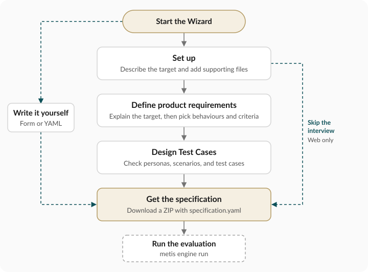

import Link from '@docusaurus/Link';
import Tabs from '@theme/Tabs';
import TabItem from '@theme/TabItem';

In the guided interview, you describe your application and the Wizard drafts the tests.

## 1. Start the Wizard

<Tabs groupId="wizard-interface">
<TabItem value="browser" label="Browser" default>

In your editor, open a terminal in the repository folder and start the Wizard:

<Terminal command="make run-web" />

Each line of output starts with the name of its server, `api` or `web`. Keep the terminal open.
Open the address that the `web` lines show, for example `http://localhost:5173`. You see the
opening screen:



</TabItem>
<TabItem value="cli" label="CLI">

Open a terminal in the repository folder and run:

<Terminal command="metis wizard init" />

To add documents, give `--document` once for each file, for example
`metis wizard init --document policy.pdf`. You see the opening screen:



</TabItem>
</Tabs>

## 2. Build Spec and/or Connect Target

Above the text box, choose:

- **Build Spec only** if you only wish to generate the `specification.yaml`
- **Build Spec and connect target** if you wish to generate both the `specification.yaml`
and the [Target connection](target-connection.md).

## 3. Describe your Target

Type a short description. Say what the application does and who uses it:

```text
A research assistant for policy staff. It answers questions about internal policy documents and cites the source of each answer.
```

You may also upload documents. They help the Wizard build more representative specifications.

## 4. Choose the Perspective

The **Perspective** says who the evaluation is for. **End user** is the default.

| Perspective | Guiding question |
|---|---|
| End user | Is the user getting what they came for? |
| Engineer | Is the agent performing as intended, correctly and efficiently? |
| Compliance | Are our responses audited, grounded, and within compliance policy scope? |
| Security | Is our target safe against malicious attacks? |

## 5. Select Capabilities

Select **Capabilities** to tell the Wizard what your application can do, such as **Tool Use** or
**File & Data Management**. Under **Confidence**, say how sure you are that the list is complete.
This step is optional. If you skip it, the capabilities stay unspecified.

## 6. Run the Interview

The **Profile** opens once you start the Interview. There are a few key steps you will go through
to complete your specification.

<Table>
  <thead>
    <tr>
      <th>Step</th>
      <th>You do this</th>
    </tr>
  </thead>
  <tbody>
    <tr>
      <th colSpan={2}><Link to="/product-requirements">Define product requirements</Link></th>
    </tr>
    <tr><td>1. Understanding your target</td><td>Answer the Wizard's questions</td></tr>
    <tr><td>2. Features / Expected Behaviours</td><td>Choose what to measure</td></tr>
    <tr><td>3. Acceptance criteria</td><td>Check each Criterion and its grader</td></tr>
    <tr>
      <th colSpan={2}><Link to="/test-scenarios">Design Test Cases</Link></th>
    </tr>
    <tr><td>4. Personas</td><td>Check the simulated users</td></tr>
    <tr><td>5. Scenarios</td><td>Check the situations to test</td></tr>
    <tr><td>6. Test Cases</td><td>Choose the tests to run, then download</td></tr>
  </tbody>
</Table>

The browser saves each interview. To open one again, select it in the list on the left.



## Next step

[Define product requirements](product-requirements.md).
