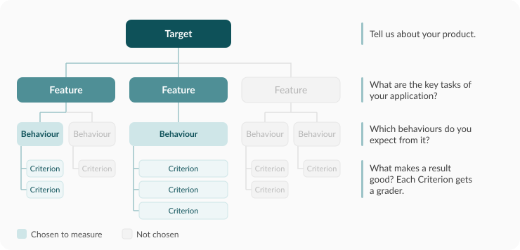

A **specification** describes what your application should do and how to test it. It turns
your product requirements into tests that METIS can run. It holds the Target and its Features,
Behaviours, Criteria, and the Test Cases that check them. METIS represents the specification
as `specification.yaml`.

## Prioritise what your application should do.

Have you ever wanted to run evals but did not know where to start? METIS helps with a
**spec-driven** approach. It takes the requirements of your product, focusing on the expected
behaviours that matter the most, and structures them into a specification for you to run your
evals.

The specification is then used to simulate and evaluate interactions, to assure you that your
product is performing as you expected.

METIS follows the four core steps in the
[Evaluation Playbook](https://go.gov.sg/evaluation-playbook).

## The Wizard guides your specifications

It maps out your Target into familiar Agile hierarchies:

- **Features** are the key tasks that your application does.
- **Expected Behaviours** are how the application must act during each task. You choose
the key behaviours that matter most.
- **Criteria** are the checks that show a Behaviour happened. Each Criterion gets a Grader.

To draft the tests, the Wizard also uses two inputs.

### 1. Perspective

Different users may have different priorities when it comes to evaluations. Agentic systems
are non-deterministic and have various capabilities, as a result, **what is most important to
evaluate** differs widely depending on your role or relationship to the Target system. The
**Perspective** is hence the point of view that you are evaluating your Target from, and the
Wizard uses that to draft the specification.

| Perspective | Guiding question |
|---|---|
| **End user** | Is the user getting what they came for? |
| **Engineer** | Is the agent performing as intended, correctly and efficiently? |
| **Compliance** | Are our responses audited, grounded, and within compliance policy scope? |
| **Security** | Is our target safe against malicious attacks? |

### 2. Capabilities

The [Agentic Risk and Capability (ARC) framework](https://go.gov.sg/agentic-risk-capability) is
a technical governance framework for identifying, assessing, and mitigating safety and security
risks in agentic AI systems.

After you select the capabilities that your application has, such as **Tool Use**, **Internet &
Search Access**, or **Code Execution**, the Wizard uses that to build the specifications.

## Choose how to build it

| | Browser | CLI |
|---|---|---|
| [Guided interview](wizard-interview.md). The Wizard asks questions and drafts the tests. Start here if you are not sure. | Answer the questions in the web client. | Run `metis wizard init`. |
| [Configure manually](specification-file.md). You already know the tests and the graders to run. | Fill in the manual form. | Write `specification.yaml` yourself. |

To run the tests against your Target system, the Engine needs to know how to connect to it. You
can set up this target connection in the web client too. See
[Target connection](target-connection.md).

## Next step

Start the [guided interview](wizard-interview.md).
